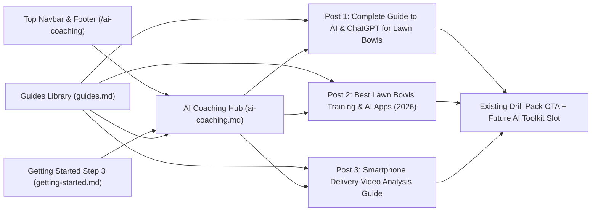

# Phase 1 Implementation Plan: AI & Lawn Bowls Coaching Pillar

## Goal Description
Establish the foundational **AI & Lawn Bowls Coaching** pillar section on Jack High Bowls (`jackhighbowls.com`) to capture emerging search demand around AI coaching, smartphone delivery video analysis, and lawn bowls training apps—while priming the site's funnel for a future AI Coaching Toolkit digital product.

Phase 1 delivers:
1. **Cornerstone Hub Page (`/ai-coaching/`)**: A curated hub styled consistently with [help-and-support.md](file:///home/reecewilliams8/dev%20work/jhb/help-and-support.md) and [guides.md](file:///home/reecewilliams8/dev%20work/jhb/guides.md) using the JHB colour palette (`#0F3D1F`, `#C89B3C`, `#F5F2EB`, `#222222`), featuring topic cards, a "Copy & Try" sample ChatGPT coaching prompt, and an automated `.masonrygrid` listing of all `ai` category posts.
2. **Three Foundational Pillar Articles (`_posts/`)**:
   - **Pillar Guide**: *How to Use AI & ChatGPT to Improve at Lawn Bowls (Complete Guide)*
   - **App & Tech Roundup**: *Best Lawn Bowls Coaching & Training Apps in 2026 (Torny, WGTS, BowlsIQ & More)*
   - **Video Analysis Guide**: *How to Film & Analyse Your Lawn Bowls Delivery With Your Smartphone*
3. **Site Navigation & Discovery Integration**:
   - Top-level navbar ([_includes/navbar.html](file:///home/reecewilliams8/dev%20work/jhb/_includes/navbar.html)) and footer navigation updates, [getting-started.md](file:///home/reecewilliams8/dev%20work/jhb/getting-started.md) skill-building card integration, SEO-safe cross-listing in [guides.md](file:///home/reecewilliams8/dev%20work/jhb/guides.md), and [llms.txt](file:///home/reecewilliams8/dev%20work/jhb/llms.txt) indexing so AI search engines (ChatGPT Search, Perplexity, Google AI Overviews) discover the new pillar immediately.

---

## Architecture & Funnel Flow



---

## Finalized Design & SEO Decisions

> [!NOTE]
> All three architectural decisions have been locked in:
> 1. **Hub URL Slug**: `/ai-coaching/` (`ai-coaching.md`).
> 2. **Top Navbar Placement**: Included directly in [_includes/navbar.html](file:///home/reecewilliams8/dev%20work/jhb/_includes/navbar.html) as **AI Coaching** alongside *Start Here*, *Guides*, and *Reviews*.
> 3. **SEO-Safe Listing in `/guides/`**:
>    - Each article uses a **single front matter category** (`categories: [ ai ]`) so Jekyll's `permalink: /:categories/:title/` generates exactly **one canonical URL** per post (`/ai/<post-slug>/`) with zero duplicate content or multi-category URL bloat (`/guide/ai/...`).
>    - In [guides.md](file:///home/reecewilliams8/dev%20work/jhb/guides.md), we update the Liquid filter to ``. This renders standard preview links pointing to the canonical `/ai/<post-slug>/` URLs, passing internal link equity from the established `/guides/` hub to the new AI articles and accelerating search indexing without any duplicate content or keyword cannibalization.

---

## Proposed Changes

### 1. Cornerstone Pillar Hub

#### [NEW] [ai-coaching.md](file:///home/reecewilliams8/dev%20work/jhb/ai-coaching.md)
Create the root-level static hub page using `layout: page` and `permalink: /ai-coaching/`.
- **Intro & Value Proposition**: Written in Reece Williams' practical, zero-jargon coaching voice explaining how modern tools (ChatGPT, smartphone slow-motion video, and dedicated bowls apps) help club bowlers practise with purpose.
- **Interactive "Try This Coaching Prompt" Callout**: A styled box (`background-color: #F5F2EB; border-left: 4px solid #0F3D1F;`) containing a ready-to-copy roll-up practice prompt that visitors can paste straight into ChatGPT.
- **Four Curated Pillar Cards**:
  1. *AI Practice & Roll-Up Planning*
  2. *Smartphone Delivery & Video Analysis*
  3. *Tactical Scenario Simulation (Leads & Skips)*
  4. *Bowls Apps & Shot-Tracking Tech*
- **Drill Pack Bridge Callout**: Highlights how combining the [Lawn Bowls Downloadable Drill Pack](file:///home/reecewilliams8/dev%20work/jhb/lawn-bowls-downloadable-drill-pack.md) with AI shot tracking accelerates consistency.
- **Automated Article Grid**:
  ```liquid
  <div class="masonrygrid row all listrecent">
    
      
        
      
    
  </div>
  ```

---

### 2. Foundational Pillar Articles (`_posts/`)

All three posts will follow the exact YAML front matter and E-E-A-T standards defined in [AGENTS.md](file:///home/reecewilliams8/dev%20work/jhb/AGENTS.md) (`layout: post`, `author: reece`, `categories: [ ai ]`, `date: 2026-11-03`, `last_modified_at: 2026-11-03 13:55:00 +0000`) and include internal links to existing JHB cornerstone guides.

#### [NEW] [2026-11-03-how-to-use-ai-and-chatgpt-for-lawn-bowls.md](file:///home/reecewilliams8/dev%20work/jhb/_posts/2026-11-03-how-to-use-ai-and-chatgpt-for-lawn-bowls.md)
- **URL**: `/ai/how-to-use-ai-and-chatgpt-for-lawn-bowls/`
- **Scope**: Comprehensive pillar guide covering 5 practical ways club bowlers can use free AI tools today:
  1. Building structured solo roll-up plans tailored to green speed and rink position.
  2. Running tactical "What Shot Would You Call?" simulations for singles and skips.
  3. Diagnosing common delivery faults (dumping, narrow line, short weight) with structured Q&A prompts.
  4. Logging Drill Pack scores to track forehand vs. backhand draw conversion rates.
  5. Understanding where AI falls short (green feel, wind shifts, physical touch) and why it complements—rather than replaces—club coaching.
- **Copy-Paste Prompts**: Includes 4 complete, tested prompts bowlers can copy immediately.

#### [NEW] [2026-11-03-best-lawn-bowls-coaching-and-training-apps.md](file:///home/reecewilliams8/dev%20work/jhb/_posts/2026-11-03-best-lawn-bowls-coaching-and-training-apps.md)
- **URL**: `/ai/best-lawn-bowls-coaching-and-training-apps/`
- **Scope**: Independent review roundup and comparison table of modern lawn bowls apps and digital tools:
  - **Torny**: AI-powered shot tracking and season performance analytics.
  - **Lawn Bowls Academy**: Structured mobile drill libraries and onboarding by skill level.
  - **BowlsIQ**: Rink-mapping, head-reading analytics, and tactical review.
  - **WGTS (Who's Got The Shot?)**: Augmented reality (AR) smartphone measuring for close heads.
  - **CoachNow / Remote Video Platforms**: Frame-by-frame delivery review with coaches.
  - **ChatGPT (Free Mobile App)**: Voice & text practice companion on the green.

#### [NEW] [2026-11-03-how-to-film-and-analyse-your-lawn-bowls-delivery.md](file:///home/reecewilliams8/dev%20work/jhb/_posts/2026-11-03-how-to-film-and-analyse-your-lawn-bowls-delivery.md)
- **URL**: `/ai/how-to-film-and-analyse-your-lawn-bowls-delivery/`
- **Scope**: Step-by-step biomechanical self-audit guide using any smartphone:
  - **Camera Setup**: Exact tripod/bag-prop placement for the two essential angles (*Down-the-Line Mat View* and *Side-On Pendulum & Stance View*) plus 60fps/120fps slow-motion settings.
  - **The 5-Checkpoint Frame Audit**: Anchor foot alignment, hip/shoulder squareness, pendulum backswing peak, lowest point of release (fixing dumping), and follow-through stability.
  - **AI Diagnostic Workflow**: How to feed your observations (or video frames) into an AI coaching prompt and cross-reference with JHB's [How to Stop Dumping Your Bowl](file:///home/reecewilliams8/dev%20work/jhb/_posts/2020-05-03-how-do-i-stop-my-lawn-bowl-from-dumping.md) and [Ultimate Guide to Weight Control](file:///home/reecewilliams8/dev%20work/jhb/_posts/2019-04-05-ultimate-guide-to-weight-control.md).

---

### 3. Navigation, Internal Funnel & Discovery Updates

#### [MODIFY] [navbar.html](file:///home/reecewilliams8/dev%20work/jhb/_includes/navbar.html)
Add the **AI Coaching** link to the primary navigation bar:
```diff
         <li class="nav-item">
           <a class="nav-link" href="{{"/guides" | relative_url }}">Guides</a>
         </li>
+        <li class="nav-item">
+          <a class="nav-link" href="{{"/ai-coaching" | relative_url }}">AI Coaching</a>
+        </li>
         <li class="nav-item">
           <a class="nav-link" href="{{"/reviews" | relative_url }}">Reviews</a>
         </li>
```

#### [MODIFY] [footer-nav.html](file:///home/reecewilliams8/dev%20work/jhb/_includes/footer-nav.html)
Add a link to `/ai-coaching` in the footer navigation list alongside *Help & Support* and *Downloadable Drill Pack*.

#### [MODIFY] [getting-started.md](file:///home/reecewilliams8/dev%20work/jhb/getting-started.md)
Add a resource card inside `#step-3` ("Build core skills and repeatable delivery") linking to `/ai-coaching` so new bowlers discover the AI practice planning and video analysis resources alongside the Drill Pack.

#### [MODIFY] [guides.md](file:///home/reecewilliams8/dev%20work/jhb/guides.md)
Add a callout link to `/ai-coaching` and update the masonry grid loop to surface both `guide` and `ai` category articles without duplicating URLs:
```diff
 <div class="masonrygrid row all listrecent">
     
-      
+      
         
       
     
 </div>
```

#### [MODIFY] [llms.txt](file:///home/reecewilliams8/dev%20work/jhb/llms.txt)
Add the new **AI & Technology Coaching** section linking `/ai-coaching/` and the 3 foundational articles so LLM crawlers index the new pillar immediately.

#### [MODIFY] [AGENTS.md](file:///home/reecewilliams8/dev%20work/jhb/AGENTS.md)
Document the new `ai-coaching.md` cornerstone page in the Cornerstone Pages table.

---

## Verification Plan

### Automated Build & Integrity Checks
1. Run `bundle exec jekyll build` in `/home/reecewilliams8/dev work/jhb` to verify zero Liquid syntax errors, valid YAML front matter, and clean HTML generation into `_site/`.
2. Verify generated output paths in `_site/`:
   - `_site/ai-coaching/index.html`
   - `_site/ai/how-to-use-ai-and-chatgpt-for-lawn-bowls/index.html`
   - `_site/ai/best-lawn-bowls-coaching-and-training-apps/index.html`
   - `_site/ai/how-to-film-and-analyse-your-lawn-bowls-delivery/index.html`
   - `_site/sitemap.xml` and `_site/llms.txt`
3. Verify all internal links referenced across the new hub and posts resolve to existing generated paths in `_site/`.

### Manual Verification
1. Run `bundle exec jekyll serve` and inspect `http://127.0.0.1:4000/ai-coaching/` and `http://127.0.0.1:4000/guides/` across mobile and desktop viewports to confirm card alignment, brand typography/colours, and `.masonrygrid` post cards.
