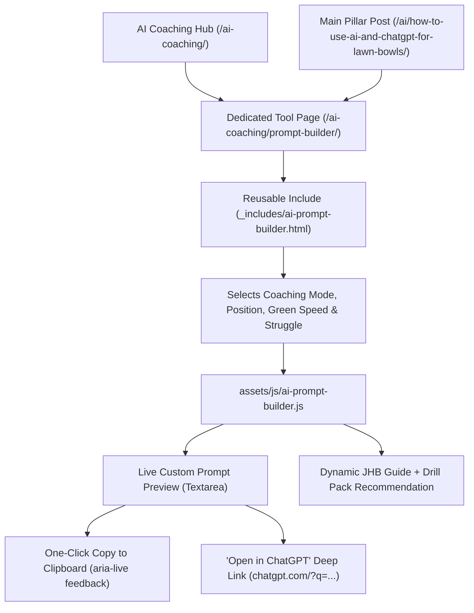

# Phase 2 Implementation Plan: Interactive Lawn Bowls AI Coaching Prompt Builder

## Goal Description
Build a client-side **Interactive Lawn Bowls AI Coaching Prompt Builder** packaged as a reusable Liquid include (`_includes/ai-prompt-builder.html`) and hosted on its own dedicated tool page (`ai-prompt-builder.md` at `/ai-coaching/prompt-builder/`), with prominent callout links from both [`/ai-coaching/`](file:///home/reecewilliams8/dev%20work/jhb/ai-coaching.md) and the main pillar guide ([`2026-11-03-how-to-use-ai-and-chatgpt-for-lawn-bowls.md`](file:///home/reecewilliams8/dev%20work/jhb/_posts/2026-11-03-how-to-use-ai-and-chatgpt-for-lawn-bowls.md)).

Beyond generating custom prompts, the tool acts as a **conversion and internal-linking engine**:
1. **One-Tap Copy & "Open in ChatGPT" Launch**: Bowlers can copy the prompt with one click or tap **"Open in ChatGPT"** (`https://chatgpt.com/?q=...`) to launch ChatGPT pre-populated with their custom lawn bowls coaching prompt.
2. **Dynamic Next-Step Recommendations**: Based on the bowler's selected struggle (e.g., *Weight Control*, *Dumping*, *Line Control*, or *Head Tactics*), the widget dynamically recommends the exact Jack High Bowls guide to read next alongside the [Downloadable Lawn Bowls Drill Pack](file:///home/reecewilliams8/dev%20work/jhb/lawn-bowls-downloadable-drill-pack.md) (and later, the Phase 3 AI Coaching Toolkit digital product).

---

## User Flow & Component Architecture



---

## Finalized Design Decisions

> [!NOTE]
> Both Phase 2 architectural choices have been locked in:
> 1. **Direct "Open in ChatGPT" Button**: Included alongside the primary **"Copy Prompt"** button (`https://chatgpt.com/?q=<encoded-prompt>`), allowing mobile and tablet users to launch ChatGPT pre-filled in one tap.
> 2. **Dedicated Tool Page + Reusable Include**:
>    - The interactive builder is built as a self-contained reusable include (`_includes/ai-prompt-builder.html`) so it can be dropped into any page or post in the future via ``.
>    - It is hosted on its own dedicated landing page (`ai-prompt-builder.md` → `/ai-coaching/prompt-builder/`), giving it a clean, shareable URL and dedicated search/LLM indexability.
>    - Both [`ai-coaching.md`](file:///home/reecewilliams8/dev%20work/jhb/ai-coaching.md) and [`2026-11-03-how-to-use-ai-and-chatgpt-for-lawn-bowls.md`](file:///home/reecewilliams8/dev%20work/jhb/_posts/2026-11-03-how-to-use-ai-and-chatgpt-for-lawn-bowls.md) link prominently to `/ai-coaching/prompt-builder/`.

---

## Proposed Changes

### 1. Reusable Liquid Component & Dedicated Tool Page

#### [NEW] [ai-prompt-builder.html](file:///home/reecewilliams8/dev%20work/jhb/_includes/ai-prompt-builder.html)
Create a semantic, accessible HTML form component (`[data-ai-prompt-builder]`) adhering to `AGENTS.md` and modern web accessibility standards:
- **Coaching Mode Selector (`<fieldset>` with 3 radio pills)**:
  1. `rollup` — *Solo Roll-Up Session Planner*
  2. `tactics` — *Match Tactics & Skip Simulator*
  3. `fault` — *Delivery Fault Troubleshooter*
- **Four Customisation Controls (with explicit `<label for="...">` above each control, `1rem` font size, and `>=48px` tap targets)**:
  - **Rink Position / Format (`#ai-position`)**: *Lead*, *Second*, *Third*, *Skip*, *Singles Player*
  - **Surface & Green Speed (`#ai-surface`)**: *Medium Outdoor Grass (13–15s)*, *Slow/Heavy Outdoor Grass (10–12s)*, *Fast Outdoor / Synthetic (16–18s)*, *Indoor Carpet*, *Short Mat*
  - **Primary Focus / Struggle (`#ai-struggle`)**:
    - *Dropping short on draw shots (Weight Control)*
    - *Missing narrow or wide of the aiming point (Line Control)*
    - *Bowl bouncing / dumping loudly on release*
    - *Forehand vs. backhand draw inconsistency*
    - *Playing weighted / conversion shots under pressure*
    - *Reading the head & calling percentage shots*
  - **Practice Time Available (`#ai-duration`)**: *30 minutes*, *45 minutes*, *60 minutes*
- **Generated Prompt Output Panel**:
  - Editable `<textarea id="ai-prompt-output" rows="6">` so users can inspect or tweak the generated prompt before copying or launching.
  - Primary button: **Copy Prompt** (`#ai-copy-btn`) with an `aria-live="polite"` feedback badge (`#ai-copy-status`).
  - Secondary link button: **Open in ChatGPT** (`#ai-chatgpt-link`, `target="_blank" rel="noopener noreferrer"`).
- **Dynamic "Recommended JHB Resource" Footer Bar**:
  - Updates automatically when `#ai-struggle` changes to link directly to the matching JHB cornerstone guide (e.g. [How to Stop Dumping Your Bowl](file:///home/reecewilliams8/dev%20work/jhb/_posts/2022-06-29-how-do-i-stop-my-lawn-bowl-from-dumping.md) or [Ultimate Guide to Weight Control](file:///home/reecewilliams8/dev%20work/jhb/_posts/2019-04-05-ultimate-guide-to-weight-control.md)) plus the [Downloadable Drill Pack](file:///home/reecewilliams8/dev%20work/jhb/lawn-bowls-downloadable-drill-pack.md).

#### [NEW] [ai-prompt-builder.md](file:///home/reecewilliams8/dev%20work/jhb/ai-prompt-builder.md)
Create the dedicated page at `/ai-coaching/prompt-builder/`:
- Uses `layout: page`, `title: "Lawn Bowls AI Coaching Prompt Builder"`, and `permalink: /ai-coaching/prompt-builder/`.
- Embeds `` followed by brief, practical instructions on how to get the best results when pasting or opening the prompt in ChatGPT, Claude, or Gemini, plus links back to `/ai-coaching/` and the [Downloadable Lawn Bowls Drill Pack](file:///home/reecewilliams8/dev%20work/jhb/lawn-bowls-downloadable-drill-pack.md).

---

### 2. Modular JavaScript & Styling

#### [NEW] [ai-prompt-builder.js](file:///home/reecewilliams8/dev%20work/jhb/assets/js/ai-prompt-builder.js)
Following `AGENTS.md` (*"JavaScript should be modular and placed under `assets/js`; avoid inline scripts when possible"*):
- Pure vanilla JavaScript (zero extra dependencies) wrapped in an IIFE that iterates over all `[data-ai-prompt-builder]` instances on the page (so multiple instances or future drops work seamlessly).
- Builds context-specific prompts for each of the 3 coaching modes (`rollup`, `tactics`, `fault`) using the selected position, surface speed, struggle, and duration.
- Updates the `https://chatgpt.com/?q=...` href dynamically (including when a user manually edits the textarea).
- Uses `navigator.clipboard.writeText()` with a fallback `textarea.select()` copy method for older browsers.
- Safely updates the recommended guide link and title using `textContent` and `setAttribute('href', ...)` (preventing any XSS).

#### [NEW] [_ai-prompt-builder.scss](file:///home/reecewilliams8/dev%20work/jhb/_sass/_ai-prompt-builder.scss)
Custom SCSS partial using the JHB brand palette (`#0F3D1F` deep green, `#C89B3C` warm gold, `#F5F2EB` neutral light, `#222222` charcoal):
- Mode selector radio pills with high-contrast `:focus-visible` outlines (`3px solid #0F3D1F`).
- `min-height: 48px` and `font-size: 1rem` on all form controls to prevent iOS Safari auto-zoom and satisfy mobile tap-target accessibility guidelines.

#### [MODIFY] [styles.scss](file:///home/reecewilliams8/dev%20work/jhb/_sass/styles.scss)
Import the new `_ai-prompt-builder` partial:
```diff
 @import "post";
 @import "video";
 @import "footer";
+@import "ai-prompt-builder";
```

#### [MODIFY] [scripts.html](file:///home/reecewilliams8/dev%20work/jhb/_includes/scripts.html)
Load `assets/js/ai-prompt-builder.js` with `defer`:
```diff
 <script src="{{"/assets/scripts.js" | relative_url }}"></script>
+<script src="{{"/assets/js/ai-prompt-builder.js" | relative_url }}" defer></script>
```

---

### 3. Cross-Linking & Discovery Updates

#### [MODIFY] [ai-coaching.md](file:///home/reecewilliams8/dev%20work/jhb/ai-coaching.md)
Update the top callout box and Practice & Roll-Up Planning card on `/ai-coaching/` to feature a prominent CTA button launching the new interactive `/ai-coaching/prompt-builder/` page.

#### [MODIFY] [2026-11-03-how-to-use-ai-and-chatgpt-for-lawn-bowls.md](file:///home/reecewilliams8/dev%20work/jhb/_posts/2026-11-03-how-to-use-ai-and-chatgpt-for-lawn-bowls.md)
Add a high-visibility callout card linking readers directly to `/ai-coaching/prompt-builder/` so they can generate a custom prompt for their position and green speed.

#### [MODIFY] [llms.txt](file:///home/reecewilliams8/dev%20work/jhb/llms.txt) & [AGENTS.md](file:///home/reecewilliams8/dev%20work/jhb/AGENTS.md)
Index `/ai-coaching/prompt-builder/` in `llms.txt` and `AGENTS.md`.

---

## Verification Plan

### Automated Build & Integrity Checks
1. Run `bundle exec jekyll build` in `/home/reecewilliams8/dev work/jhb` to verify SCSS compilation of `_sass/_ai-prompt-builder.scss` into `_site/assets/main.css` and generation of `_site/ai-coaching/prompt-builder/index.html`.
2. Verify that `_site/assets/js/ai-prompt-builder.js` is copied to `_site/` and linked properly in the generated HTML.
3. Run an automated link and DOM verification script to confirm zero broken internal links across `/ai-coaching/`, `/ai-coaching/prompt-builder/`, and all `/ai/` articles.
