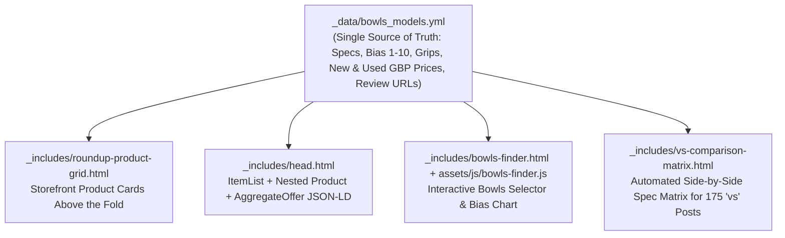

# "Best X for Y" Buyer's Guides — SERP Recovery & Storefront UX Master Plan (`jackhighbowls.com`)

## 1. Executive Summary & Root-Cause Diagnosis

### Why Ecommerce Stores Are Outranking Informational Roundups
Google's recent Core and Reviews updates shifted the SERP layout for **"Best X for Y"** commercial investigation queries (e.g., *"best narrow bowls"*, *"best lawn bowls for beginners"*, *"best indoor bowls"*, *"best lawn bowls shoes"*). For these queries, Google increasingly favours:
1. **Ecommerce Category / Product Listing Pages (PLPs)** that immediately display scannable product grids, live pricing, and faceted filters above the fold.
2. **Pages with Rich Product / ItemList Structured Data** (`ItemList` with nested `Product`, `Brand`, `Review`, and `AggregateOffer` price ranges) that feed Google's Merchant/Product knowledge graph and AI Overviews.
3. **Interactive Comparison & Filtering Tools** that satisfy comparison shopping intent across multiple brands without forcing users to read 800 words of introductory prose before seeing a product recommendation.

### What Our Codebase Audit Revealed on JHB
An audit of the `_posts/`, `_layouts/`, and `_includes/` directories identified **five specific structural issues** holding back JHB's "Best X for Y" rankings:

| Issue | Current State in Repository | SEO & Conversion Impact |
| :--- | :--- | :--- |
| **1. Incomplete Schema Rollout (4 of 26 Guides)** | [`_includes/head.html`](../_includes/head.html) supports `ItemList` (`page.items`) and `FAQPage` (`page.faqs`) JSON-LD, but **only 4 posts** (`best-lawn-bowls-for-beginners`, `best-rated-bowls-for-leads`, `best-lawn-bowls-for-fast-greens`, `best-lawn-bowls-for-skips`) have `items:` and `faqs:` front matter. The remaining **22 "Best" guides** have zero `ItemList` or `FAQPage` markup. | Search engines and AI Overviews cannot extract structured product rankings, awards, or FAQs from 85% of JHB's buyer's guides. |
| **2. Basic `ItemList` Without `Product` or `AggregateOffer` Nodes** | In [`_includes/head.html`](../_includes/head.html), each `ListItem` only outputs `name`, `description`, and `url`. It does not nest a `Product` entity with `brand`, `reviewRating`, or `offers: { "@type": "AggregateOffer", "lowPrice": ..., "highPrice": ..., "priceCurrency": "GBP" }`. | Ecommerce stores win rich price snippets in SERPs while JHB appears as a plain text link. |
| **3. Legacy Blog Layout & Outdated Pricing on 20+ Roundups** | Posts like [`2020-10-29-best-straight-lawn-bowls.md`](../_posts/2020-10-29-best-straight-lawn-bowls.md), [`2020-08-05-best-lawn-bowls-for-indoors.md`](../_posts/2020-08-05-best-lawn-bowls-for-indoors.md), and [`2022-04-22-best-mid-bias-lawn-bowls.md`](../_posts/2022-04-22-best-mid-bias-lawn-bowls.md) use unstyled WordPress `.wp-block-table` tables, quote outdated 2020 prices (£279–£299 for new bowls that now cost £375–£450), contain dead `<a href="#">` image wrappers, and bury actual model picks below 50+ lines of generic intro text. | High pogo-sticking rate when commercial-intent visitors land on a wall of text instead of scannable product cards. |
| **4. Missing Exact-Match Keyword Modifiers** | For example, [`2020-10-29-best-straight-lawn-bowls.md`](../_posts/2020-10-29-best-straight-lawn-bowls.md) is titled `"7 Best Straight Lawn Bowls | A Helpful Guide"`, omitting the high-volume **"Narrow"** / **"Narrow Bias"** modifier from the `<title>` and `<h1>`. | Loses relevance for `"best narrow lawn bowls"` and `"narrowest bias lawn bowls"` queries. |
| **5. Cannibalization & Thin Content Across 175 `"X vs Y | Which is Best?"` Posts** | In March 2023, ~175 programmatic head-to-head posts (e.g., [`2023-03-22-taylor-ace-vs-henselite-tiger-pro-which-is-best.md`](../_posts/2023-03-22-taylor-ace-vs-henselite-tiger-pro-which-is-best.md)) were published. Nearly all have **`description: ""` (empty meta description)**, repetitive AI-style paragraphs with no spec table, and `"Which is Best?"` appended to every title. | Dilutes crawl budget, triggers Helpful Content / Scaled Content quality suppression across the `/review/` and `/guide/` directories, and cannibalizes "Best" keyword intent. |

---

## 2. JHB's Unfair Advantage Over Ecommerce Stores

Single-retailer ecommerce stores have three blind spots that JHB can exploit to reclaim the #1 spot:
1. **Cross-Brand Bias Objectivity**: No manufacturer (Taylor, Henselite, Aero, Drakes Pride) publishes an honest side-by-side draw trajectory chart comparing their bowls against competitors on a unified 1–10 bias scale.
2. **New vs. Second-Hand (eBay) Pricing Transparency**: Retail stores only list new RRP (£365–£460). Yet over 60% of beginner and club bowlers searching *"best bowls for beginners"* or *"best narrow bowls"* are also weighing whether to buy a second-hand set (£90–£220) with a valid World Bowls stamp. Showing **New RRP alongside Typical Second-Hand Market Price** + direct eBay & retailer comparison CTAs immediately gives our pages higher utility than any single shop.
3. **Interactive Cross-Brand Filtering by Role, Green Speed & Hand Size**: Retail category filters only sort by Price, Brand, or Size in stock. JHB can offer an interactive **Bowls Finder & Bias Comparator** that filters by *Position (Lead / Second / Third / Skip)*, *Surface (Indoor Carpet / Fast Outdoor / Heavy Outdoor / Crown Green)*, *Grip Style (Embedded / Dimple / Scoop / Plain)*, and *Budget (Second-Hand vs. New)*.

---

## 3. Target Architecture & Technical Components



### 3.1 Central Equipment Dataset (`_data/bowls_models.yml`)
Create a canonical YAML database of major lawn bowls models (Taylor Ace, Vector VS, Lazer, International, Blaze, Lignoid; Drakes Pride Professional, Pro-50, XP, d-tec, Fineline, Advantage, Crown Green; Henselite Tiger, Tiger II, Tiger Pro, Tiger EVO, Classic II, Dreamline XG; Aero Quantum, GrooVe, Sonic, Defiance, Profile, Optima).
Each entry stores:
- `id`, `brand`, `name`, `slug`, `review_url`, `image`
- `bias_score` (numeric `1.0` to `10.0`, where `1.0` is ultra-narrow indoor and `10.0` is wide heavy-green/skip)
- `bias_label` (e.g., `"Narrow (2.5/10)"`, `"Mid-Bias (5.0/10)"`)
- `finish_profile` (e.g., `"Flat, gradual finish"`, `"Pronounced late hook"`)
- `surfaces` (array: `["Indoor Carpet", "Fast Outdoor", "Slow/Heavy Outdoor"]`)
- `ideal_positions` (array: `["Lead", "Second", "Pairs"]`)
- `grips` (array: `["Progrip", "Xtreme", "Plain"]`)
- `sizes` (`"0000 to 5"`)
- `price_new_gbp` (e.g., `395`)
- `price_used_low_gbp` / `price_used_high_gbp` (e.g., `110` / `170`)
- `ebay_search_query` (for generating targeted second-hand search links)
- `rating` (e.g., `4.8`)

### 3.2 Storefront Roundup Product Grid (`_includes/roundup-product-grid.html` & `_sass/_roundup-cards.scss`)
Placed immediately below the "Quick Verdict" callout on every "Best X for Y" guide:
- **Above-the-Fold Storefront Layout**: Renders a 2-column or full-width product card grid matching ecommerce visual scannability while adhering strictly to [`.agents/brand-colours.md`](brand-colours.md):
  - Sharp square corners (`border-radius: 0;`) on all cards, containers, tables, and action buttons.
  - Fully rounded pills (`border-radius: 9999px;`) exclusively for award badges, bias tags, and surface pills.
  - Deep Blue (`#1F2B5F`) primary headers/CTAs, Warm Gold (`#C89B3C`) award accents/stars, Neutral Light (`#f8f9fa`) spec panels, and Dark Charcoal (`#222222`) typography.
- **Card Content**:
  - Rank badge (`#1 Best Overall`, `#2 Best Value Used`, etc.)
  - Product image + linked model title + star rating
  - Visual **Bias Meter Bar** (`1–10` scale from Narrow/Straight to Wide/Hook)
  - Spec summary pills (Surface, Ideal Position, Grip Options)
  - **Dual Pricing Box**: `New RRP: ~£395` | `Used (eBay): £110–£160`
  - **Action Buttons**: `"Read Our Review →"` (internal link to model review) and `"Check Used & New Availability"` (affiliate/search link).

### 3.3 Enriched `ItemList` + `Product` + `AggregateOffer` Schema (`_includes/head.html`)
Upgrade Section 5 (`ItemList Schema for Buyer's Guides & Product Roundups`) in [`_includes/head.html`](../_includes/head.html) so that when an item includes pricing or maps to `_data/bowls_models.yml` (or specifies `brand`, `price_low`, `price_high`, `rating`), the `ListItem.item` outputs a structured `Product` entity:
```json
{
  "@type": "ListItem",
  "position": 1,
  "item": {
    "@type": "Product",
    "name": "Taylor Ace",
    "url": "https://www.jackhighbowls.com/review/bowls/taylor-ace-review/",
    "brand": { "@type": "Brand", "name": "Taylor Bowls" },
    "description": "The benchmark mid-bias bowl in the UK...",
    "offers": {
      "@type": "AggregateOffer",
      "priceCurrency": "GBP",
      "lowPrice": "110.00",
      "highPrice": "395.00",
      "offerCount": "2"
    }
  }
}
```

### 3.4 Interactive Bowls Finder & Cross-Brand Bias Chart (`_includes/bowls-finder.html` + `assets/js/bowls-finder.js`)
A lightweight, zero-dependency vanilla JS interactive tool embedded on [`reviews.md`](../reviews.md) and inside core "Best Bowls" buyer's guides:
- **Interactive Controls**:
  1. **Primary Surface**: *All Surfaces*, *Indoor Carpet*, *Fast Outdoor / Synthetic*, *Slow / Heavy UK Grass*, *Crown Green*.
  2. **Team Position**: *All Positions*, *Lead / Front-End*, *Second / Third*, *Skip / Back-End*, *Singles*.
  3. **Bias Preference**: *Narrow / Straight (1–3.5)*, *Mid-Bias All-Rounder (4–6)*, *Wide / Swinging (6.5–10)*.
  4. **Small Hands / Deep Grip Friendly**: Toggle filter.
- **Visual Output**:
  - Instant filtered product cards + an interactive **Cross-Brand Bias Comparison Scale** plotting Taylor, Henselite, Drakes Pride, and Aero models side-by-side from narrowest to widest.

### 3.5 Remediating the 175 `"X vs Y | Which is Best?"` Posts
To eliminate thin-content drag and keyword cannibalization across the 175 head-to-head comparison posts:
1. **Populate Missing Meta Descriptions**: Automatically generate unique, data-rich 145–160 character `description:` fields for all ~165 `vs` posts that currently have `description: ""`.
2. **De-Cannibalize Titles**: Add `seo_title` front matter to `vs` posts using the pattern `"[Model A] vs [Model B]: Bias, Grip & Price Comparison (2026)"` so they target head-to-head comparison queries without cannibalizing `"Best [Category] Bowls"` roundups.
3. **Auto-Inject Side-by-Side Spec Matrix**: Update [`_layouts/post.html`](../_layouts/post.html) (or include `_includes/vs-comparison-matrix.html`) so any post matching ` vs ` automatically renders a quantitative side-by-side comparison table (Bias Score, Trajectory Finish, Surface Suitability, Grip Options, New Price, Used Price Range, Verdict Winner) pulled directly from `_data/bowls_models.yml`.

---

## 4. Complete Inventory of "Best X for Y" Guides to Upgrade

### Cluster A: Bias & Surface Bowls Roundups (Task `BG-02`)
1. [`_posts/2020-10-29-best-straight-lawn-bowls.md`](../_posts/2020-10-29-best-straight-lawn-bowls.md) — **Retitle/H1 to include "Narrow"**: *"7 Best Narrow & Straight Lawn Bowls (2026 Bias Guide)"*
2. [`_posts/2022-04-22-best-mid-bias-lawn-bowls.md`](../_posts/2022-04-22-best-mid-bias-lawn-bowls.md) — *"Best Mid-Bias Lawn Bowls (2026 All-Rounder Buyer's Guide)"*
3. [`_posts/2020-08-05-best-lawn-bowls-for-indoors.md`](../_posts/2020-08-05-best-lawn-bowls-for-indoors.md) — *"Best Lawn Bowls for Indoors (2026 Carpet & Narrow-Bias Guide)"*
4. [`_posts/2019-07-25-best-lawn-bowls-for-fast-greens.md`](../_posts/2019-07-25-best-lawn-bowls-for-fast-greens.md) — Add storefront product grid & enriched `items` pricing fields
5. [`_posts/2022-04-18-the-best-cheap-lawn-bowls.md`](../_posts/2022-04-18-the-best-cheap-lawn-bowls.md) — *"Best Cheap & Second-Hand Lawn Bowls Under £200 (2026 Guide)"*
6. [`_posts/2022-04-06-best-yellow-lawn-bowls.md`](../_posts/2022-04-06-best-yellow-lawn-bowls.md) — *"Best Yellow & Coloured Lawn Bowls (2026 Brand Guide)"*

### Cluster B: Player Role, Hand Size & Crown Green Roundups (Task `BG-03`)
1. [`_posts/2019-04-09-best-lawn-bowls-for-beginners.md`](../_posts/2019-04-09-best-lawn-bowls-for-beginners.md) — Integrate new storefront product card grid & interactive Bowls Finder
2. [`_posts/2018-01-12-best-rated-bowls-for-leads.md`](../_posts/2018-01-12-best-rated-bowls-for-leads.md) — Integrate storefront product card grid & enriched `items` pricing
3. [`_posts/2022-04-01-best-lawn-bowls-for-skips.md`](../_posts/2022-04-01-best-lawn-bowls-for-skips.md) — Integrate storefront product card grid & enriched `items` pricing
4. [`_posts/2019-07-10-best-lawn-bowls-for-small-hands.md`](../_posts/2019-07-10-best-lawn-bowls-for-small-hands.md) — Add `items`, `faqs`, deep-grip comparison table, and storefront product cards
5. [`_posts/2020-07-11-best-lawn-bowls-for-ladies.md`](../_posts/2020-07-11-best-lawn-bowls-for-ladies.md) — Add `items`, `faqs`, size/grip matrix, and storefront product cards
6. [`_posts/2022-10-14-what-is-the-best-size-of-bowls-for-a-lady.md`](../_posts/2022-10-14-what-is-the-best-size-of-bowls-for-a-lady.md) — Add `faqs`, sizing chart table, and cross-link to `best-lawn-bowls-for-ladies`
7. [`_posts/2020-10-01-best-junior-lawn-bowls.md`](../_posts/2020-10-01-best-junior-lawn-bowls.md) — Add `items`, `faqs`, size 0000–0 comparison table, and storefront cards
8. [`_posts/2022-06-07-best-crown-green-bowls-for-beginners-a-complete-buyers-guide.md`](../_posts/2022-06-07-best-crown-green-bowls-for-beginners-a-complete-buyers-guide.md) — Add `items`, `faqs`, weight/density comparison table, and storefront cards
9. [`_posts/2022-05-16-best-make-of-crown-green-bowls.md`](../_posts/2022-05-16-best-make-of-crown-green-bowls.md) — Add `items`, `faqs`, and comparison matrix

### Cluster C: Shoes, Bags, Grips & Brand Roundups (Task `BG-04`)
1. [`_posts/2020-09-17-best-lawn-bowls-shoes.md`](../_posts/2020-09-17-best-lawn-bowls-shoes.md) — Add `items`, `faqs`, storefront shoe cards, and trainer vs. traditional comparison table
2. [`_posts/2020-07-11-best-bowling-shoes-for-ladies.md`](../_posts/2020-07-11-best-bowling-shoes-for-ladies.md) — Add `items`, `faqs`, and storefront shoe cards
3. [`_posts/2022-06-07-best-cheap-lawn-bowls-shoes.md`](../_posts/2022-06-07-best-cheap-lawn-bowls-shoes.md) — Add `items`, `faqs`, and budget shoe comparison table
4. [`_posts/2019-05-01-best-lawn-bowls-bags.md`](../_posts/2019-05-01-best-lawn-bowls-bags.md) — Add `items`, `faqs`, and bag capacity comparison table
5. [`_posts/2019-09-07-best-wheeled-trolleys.md`](../_posts/2019-09-07-best-wheeled-trolleys.md) — Add `items`, `faqs`, and wheeled trolley comparison table
6. [`_posts/2020-07-01-best-lawn-bowls-grip-enhancers.md`](../_posts/2020-07-01-best-lawn-bowls-grip-enhancers.md) — Add `items`, `faqs`, and wax/polish comparison table
7. [`_posts/2021-04-27-best-lawn-bowl-grips.md`](../_posts/2021-04-27-best-lawn-bowl-grips.md) — Add `items`, `faqs`, and brand grip depth comparison table
8. [`_posts/2020-06-10-best-lawn-bowls-brands.md`](../_posts/2020-06-10-best-lawn-bowls-brands.md) — Add `items`, `faqs`, and brand comparison matrix

---

## 5. Phased Implementation Backlog (`BG-01` – `BG-07`)

| Task ID | Title | Owner | Priority | Depends On |
| :--- | :--- | :--- | :--- | :--- |
| **`BG-01`** | Create `_data/bowls_models.yml`, Storefront Roundup Product Grid component, and Enriched `Product`/`AggregateOffer` Schema | 🤖 Agent (Frontend Implementation) | Highest | None |
| **`BG-02`** | Upgrade Bias & Surface "Best Lawn Bowls" Buyer's Guides (Narrow/Straight, Mid-Bias, Indoors, Fast Greens, Cheap/Used, Yellow) | 🤖 Agent (Content Curator) | Highest | `BG-01` |
| **`BG-03`** | Upgrade Player Fit, Role & Crown Green "Best Lawn Bowls" Buyer's Guides (Small Hands, Ladies, Juniors, Beginners, Leads, Skips, Crown Green) | 🤖 Agent (Content Curator) | High | `BG-01` |
| **`BG-04`** | Upgrade Footwear, Bags, Trolleys & Grip Accessories "Best Of" Roundups | 🤖 Agent (Content Curator) | High | `BG-01` |
| **`BG-05`** | Build Interactive Bowls Finder & Cross-Brand Bias Comparison Chart Widget | 🤖 Agent (Frontend Implementation) | High | `BG-01` |
| **`BG-06`** | Remediate 175 `"X vs Y"` Comparison Posts (Meta Descriptions, De-Cannibalized Titles & Automated Side-by-Side Spec Matrix) | 🤖 Agent (Content Curator) | Medium | `BG-01` |
| **`BG-07`** | Buyer's Guide Hub Integration, Bidirectional Review Cross-Linking & Schema/Build Verification | 🤖 Agent (Quality Assurance) | Medium | `BG-02`, `BG-03`, `BG-04`, `BG-05`, `BG-06` |

