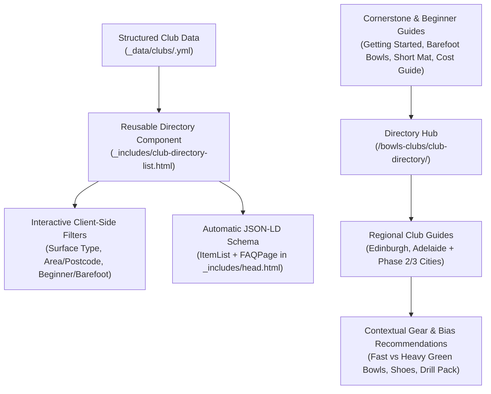

# Bowls Club Directory — Audit, UX Upgrade & SEO Action Plan (`jackhighbowls.com`)

## 1. Current Inventory & Root-Cause Audit

Three pages currently exist under the `bowls-clubs` category:

| Page Role | File Path | Published URL | Current State |
| :--- | :--- | :--- | :--- |
| **Directory Hub** | [`_posts/2022-06-01-club-directory.md`](../_posts/2022-06-01-club-directory.md) | `/bowls-clubs/club-directory/` | Links only to Edinburgh and Adelaide; displays empty `<h2>` headings for *England*, *Wales*, *Ireland*, and *New Zealand*. |
| **Edinburgh Listing** | [`_posts/2022-05-02-bowls-clubs-in-edinburgh.md`](../_posts/2022-05-02-bowls-clubs-in-edinburgh.md) | `/bowls-clubs/bowls-clubs-in-edinburgh/` | Lists 22 clubs alphabetically from *Ardmillan* to *Edinburgh Bowling Club* (truncates at letter **E**, omitting F–Z clubs like Leith and Morningside despite naming them in the intro). |
| **Adelaide Listing** | [`_posts/2022-05-02-bowls-clubs-in-adelaide-south-australia.md`](../_posts/2022-05-02-bowls-clubs-in-adelaide-south-australia.md) | `/bowls-clubs/bowls-clubs-in-adelaide-south-australia/` | Lists only 7 clubs (mostly starting with "A") out of 40+ metropolitan Adelaide clubs. |

### Why These Pages Have Not Gained Traction

| # | Bottleneck | Technical / Editorial Cause | Impact on Search & Engagement |
| :--- | :--- | :--- | :--- |
| **1** | **Complete Orphan Status (Zero Internal Links)** | Neither [`_includes/navbar.html`](../_includes/navbar.html), [`_includes/footer-nav.html`](../_includes/footer-nav.html), [`getting-started.md`](../getting-started.md), nor high-traffic beginner posts link to `/bowls-clubs/club-directory/`. | Search engines treat orphan pages as low-importance; human visitors have no pathway to discover the directory. |
| **2** | **Broken Breadcrumb & Schema Hierarchy** | [`_includes/breadcrumbs.html`](../_includes/breadcrumbs.html) and [`_includes/head.html`](../_includes/head.html) do not map `bowls-clubs` to a parent hub, so breadcrumbs on city pages fall back to `/all-posts/` instead of `/bowls-clubs/club-directory/`. | Wastes internal link equity and fails to establish a topical hub-and-spoke cluster in `BreadcrumbList` JSON-LD. |
| **3** | **Thin / Incomplete Content & Zero "Information Gain"** | Empty country headings on the hub page; alphabetically cut-off club lists; entries contain only raw address + `surface: outdoor` + occasional dead HTTP links (`http://www.ee.ed.ac.uk/~adr/ckbchome.htm`). | Google's Local Map Pack already displays Name + Address + Website on the SERP. Pages that offer no additional context fail Helpful Content checks. |
| **4** | **Empty Meta Descriptions** | All 3 posts have `description: ""` in YAML frontmatter. On the hub page (which opens with an ``), [`_includes/head.html`](../_includes/head.html) falls back to the generic site description. | Poor SERP click-through rate (CTR) and duplicate meta description signals. |
| **5** | **Unstyled WordPress Gutenberg Markup** | Club entries are wrapped in `<div class="wp-block-columns">` and `<div class="wp-block-column">`, which have no CSS rules in `_sass/` or [`assets/vendor/startbootstrap-clean-blog/scss/_global.scss`](../assets/vendor/startbootstrap-clean-blog/scss/_global.scss). | Renders as a plain vertical stack of text instead of a scannable multi-column card grid. |
| **6** | **Mismatched Layout Callout & Missing Schema** | Using `layout: post` injects the product *"How we test: Every article follows our review methodology"* banner ([`_layouts/post.html`](../_layouts/post.html)) on directory pages, while lacking `ItemList` and `FAQPage` JSON-LD schema. | Confuses visitor intent and misses rich result eligibility. |

---

## 2. Technical, Data & UX Architecture Plan



### 2.1 Structured Data-Driven Club Listings (`_data/clubs/*.yml`)
Replace hardcoded WordPress column HTML with clean YAML data files under `_data/clubs/` (e.g., `_data/clubs/edinburgh.yml`, `_data/clubs/adelaide.yml`).

**Recommended Club Entry Schema:**
```yaml
- name: "Bainfield Bowling Club"
  area: "West Edinburgh"
  address: "34 Hutchison Crossway, Edinburgh"
  postcode: "EH14 1RU"
  surfaces: ["Indoor Carpet", "Outdoor Grass"]
  formats: ["Flat Green", "Indoor"]
  beginner_friendly: true
  barefoot_social: true
  loan_bowls: true
  website: "https://www.bainfieldbowlingclub.co.uk/"
  maps_query: "Bainfield+Bowling+Club+Edinburgh+EH14+1RU"
  notes: "Features both an 8-rink indoor stadium for winter play and outdoor grass greens."
```

### 2.2 Reusable Card Grid & Instant Filter Partial (`_includes/club-directory-list.html`)
Build a Bootstrap-based partial styled with the brand palette (`#1F2B5F` Deep Blue, `#C89B3C` Warm Gold, `#f8f9fa` Neutral Light, `#222222` Charcoal):
- **Filter Bar**: Filter pills for `All`, `Indoor`, `Outdoor`, `Beginner / Social Friendly`, plus a live text search input for suburb or postcode.
- **Club Card UI**: Displays club name, suburb/postcode badge, surface badges (`Outdoor Grass`, `Outdoor Synthetic`, `Indoor Carpet`, `Short Mat`, `Crown Green`), short editorial note, verified HTTPS website link, and a direct "View on Google Maps" link.
- **Optional Map Embed**: Lightweight Leaflet + OpenStreetMap embed (no API billing required) or curated Google My Maps embed showing club pins across the city.

### 2.3 Template, Breadcrumb & Schema Fixes
1. **[`_includes/breadcrumbs.html`](../_includes/breadcrumbs.html) & [`_includes/head.html`](../_includes/head.html)**:
   - Add an `elsif cat_slug == 'bowls-clubs'` branch that sets `parent_name = 'Club Directory'` and `parent_url = '/bowls-clubs/club-directory/'` (except when viewing `/bowls-clubs/club-directory/` itself, where the parent should be `Home`).
2. **[`_layouts/post.html`](../_layouts/post.html)**:
   - Hide `.review-methodology-callout` when `page.categories contains 'bowls-clubs'`.
3. **Structured Data (`ItemList` + `FAQPage`)**:
   - Populate `faqs` and `items` (or auto-generate `ItemList` from `site.data.clubs[page.club_region]`) in [`_includes/head.html`](../_includes/head.html) so search engines index the full club list and regional FAQs.

---

## 3. Content & SEO Strategy

### 3.1 Positioning: How to Beat Generic Directories ("Information Gain")
Competing head-on with Bowls England, Bowls Scotland, or Bowls Australia on raw address lookups is a losing battle. Instead, Jack High Bowls should own **three high-intent search angles** that official NGB directories serve poorly:

| Search Pillar | Target Keyword Modifiers | Why JHB Wins |
| :--- | :--- | :--- |
| **1. Indoor, Winter & Short Mat Bowls** | `indoor bowls clubs in [city/county]`, `short mat bowls clubs [county]`, `winter bowls [city]` | Every September in the UK, thousands of outdoor bowlers and newcomers search for indoor rinks. Official NGB directories rarely separate indoor/short-mat venues clearly. |
| **2. Casual, Barefoot & Beginner Roll-Ups** | `barefoot bowls [city]`, `social lawn bowls [city]`, `beginner friendly bowls clubs [city]` | High search volume in Australian metro areas (*Barefoot Bowls* / *Night Owls*) and UK cities. Visitors want to know dress code, bar/social atmosphere, and whether loan bowls are provided. |
| **3. Crown Green vs. Flat Green Clarity** | `crown green bowls clubs in [county/city]`, `flat green vs crown green clubs [region]` | In the North of England and Midlands (Yorkshire, Greater Manchester, Lancashire, Cheshire, Warwickshire), bowlers need to know which code a club plays. |

### 3.2 Regional Green Speed & Equipment Bridge (Affiliate Monetization)
Every regional club guide should include a dedicated **"Local Green Conditions & What Equipment Works Best in [Region]"** section:
- **UK / Scottish Outdoor Grass Greens (e.g., Edinburgh)**: Explain that 10–13 second outdoor grass greens favour mid-to-wide bias models ([Taylor Ace](/review/bowls/taylor-ace-review/), [Drakes Pride Professional](/review/bowls/drakes-pride-professional-review/), [Henselite Tiger II](/review/bowls/henselite-tiger-ii-lawn-bowls-review/)), while indoor centres require a narrower draw line.
- **Australian Fast Couch / Synthetic / Dome Greens (e.g., Adelaide)**: Explain that 15–18 second greens suit narrower-bias models ([Best Lawn Bowls for Fast Greens](/guide/best-lawn-bowls-for-fast-greens/), [Taylor Redline SR](/review/bowls/taylor-redline-sr-review/), [Henselite Tiger](/review/bowls/henselite-tiger-lawn-bowls-review/)).
- **First-Timer Kit Checklist**: Link to [Lawn Bowls Dress Code](/help/lawn-bowls-dress-code/), [Best Lawn Bowls for Beginners](/guide/best-lawn-bowls-for-beginners/), [Bowl Size Guide](/help/what-size-lawn-bowl-should-i-use/), and the [Downloadable Drill Pack](/lawn-bowls-downloadable-drill-pack/).

### 3.3 Internal Linking Flywheel
Link **into** `/bowls-clubs/club-directory/` (and relevant city pages) from:
1. **[`getting-started.md`](../getting-started.md)** — Add an action card in Step 1 or Step 4: *"Find a Local Bowls Club Near You"*.
2. **[`_includes/footer-nav.html`](../_includes/footer-nav.html)** — Add *"Bowls Club Directory"* under the **Resources** column.
3. **[`_posts/2019-08-06-barefoot-bowls.md`](../_posts/2019-08-06-barefoot-bowls.md)** — Link directly to the Adelaide directory (and future Australian/UK city pages) in the "Where to play barefoot bowls" section.
4. **[`_posts/2018-03-01-guide-to-short-mat-bowls.md`](../_posts/2018-03-01-guide-to-short-mat-bowls.md)** — Link the `#find-a-club` section to `/bowls-clubs/club-directory/`.
5. **[`_posts/2020-06-16-how-much-does-lawn-bowls-cost.md`](../_posts/2020-06-16-how-much-does-lawn-bowls-cost.md)** & **[`_posts/2020-10-30-6-tips-for-beginner-lawn-bowlers.md`](../_posts/2020-10-30-6-tips-for-beginner-lawn-bowlers.md)** — Add contextual links to the directory hub.

---

## 4. Phased Implementation Roadmap & Action Items

### Phase 1: Technical Foundation & Existing Page Overhaul (Immediate Priority)

| ID | Task | Target Files | Owner |
| :--- | :--- | :--- | :--- |
| [**CD-01**](backlog/CD-01-club-directory-breadcrumbs-layout-and-schema.md) | **Fix Breadcrumbs, Post Layout Callout & Schema for `bowls-clubs`**<br>Map `bowls-clubs` in `breadcrumbs.html` and `head.html` to `/bowls-clubs/club-directory/`; hide `.review-methodology-callout` on `bowls-clubs` pages in `_layouts/post.html`; support `ItemList` generation from `_data/clubs/`. | [`_includes/breadcrumbs.html`](../_includes/breadcrumbs.html), [`_includes/head.html`](../_includes/head.html), [`_layouts/post.html`](../_layouts/post.html) | 🤖 Agent |
| [**CD-02**](backlog/CD-02-club-directory-card-grid-and-filter-component.md) | **Build Reusable Club Card Grid & Filter Component**<br>Create `_includes/club-directory-list.html` and `_sass/_club-directory.scss` using brand colours (`#1F2B5F`, `#C89B3C`, `#f8f9fa`) with instant client-side filtering by surface (Indoor/Outdoor) and search query. | `_includes/club-directory-list.html`, `_sass/_club-directory.scss`, [`assets/main.scss`](../assets/main.scss) | 🤖 Agent |
| [**CD-03**](backlog/CD-03-rebuild-club-directory-hub-page.md) | **Rebuild the Club Directory Hub Page**<br>Remove empty country headings in `2022-06-01-club-directory.md`; add a complete meta description, "How to Choose & Join Your First Bowls Club" guide, links to featured city guides, official NGB club-finder links for uncovered regions, and `faqs` frontmatter. | [`_posts/2022-06-01-club-directory.md`](../_posts/2022-06-01-club-directory.md) | 🤖 Agent |
| [**CD-04**](backlog/CD-04-complete-edinburgh-bowls-clubs-guide.md) | **Complete & Upgrade the Edinburgh Bowls Clubs Guide**<br>Create `_data/clubs/edinburgh.yml` covering A–Z clubs (adding missing F–Z clubs: Leith, London Road Foundry, Maitland, Morningside, Northern, Parkside, Sighthill, Tanfield, Willowbrae, Meadowmill Indoor, etc.); add local green speed & bowl bias advice + FAQs. | `_data/clubs/edinburgh.yml`, [`_posts/2022-05-02-bowls-clubs-in-edinburgh.md`](../_posts/2022-05-02-bowls-clubs-in-edinburgh.md) | 🤖 Agent |
| [**CD-05**](backlog/CD-05-complete-adelaide-bowls-clubs-guide.md) | **Complete & Upgrade the Adelaide Bowls Clubs Guide**<br>Create `_data/clubs/adelaide.yml` expanding from 7 to 20+ metro clubs across CBD, North, South, East, and West/Coast (e.g., Adelaide, Holdfast Bay, Lockleys, Marion, Norwood, Sturt, Walkerville, Salisbury); highlight Night Owls / Barefoot Bowls & covered dome greens + fast-green bowl bias advice + FAQs. | `_data/clubs/adelaide.yml`, [`_posts/2022-05-02-bowls-clubs-in-adelaide-south-australia.md`](../_posts/2022-05-02-bowls-clubs-in-adelaide-south-australia.md) | 🤖 Agent |
| [**CD-06**](backlog/CD-06-club-directory-internal-linking-and-sitemap.md) | **Wire Internal Links from Hub Pages & Beginner Guides**<br>Link to `/bowls-clubs/club-directory/` from `getting-started.md`, `_includes/footer-nav.html`, `2019-08-06-barefoot-bowls.md`, `2018-03-01-guide-to-short-mat-bowls.md`, and `2020-06-16-how-much-does-lawn-bowls-cost.md`. | [`getting-started.md`](../getting-started.md), [`_includes/footer-nav.html`](../_includes/footer-nav.html), `_posts/*.md` | 🤖 Agent |

### Phase 2: UK High-Intent Regional Expansion ([`CD-07`](backlog/CD-07-uk-regional-club-directory-expansion.md))
Focus on high-participation UK hubs where `jackhighbowls.com` already holds strong topical authority:
1. **Glasgow & West of Scotland Bowls Clubs** (Indoor & Outdoor Guide)
2. **London Lawn & Indoor Bowls Clubs** (Beginner, Casual & Winter Rinks Guide)
3. **Bristol, Bath, Somerset & Wiltshire Bowls Clubs** (Outdoor, Indoor & Short Mat Guide)
4. **Greater Manchester & Lancashire Bowls Clubs** (Crown Green & Flat Green Guide)
5. **Yorkshire Bowls Clubs** (Crown Green, Flat Green & Indoor Guide)

### Phase 3: Australian & NZ Metro Expansion ([`CD-08`](backlog/CD-08-australia-nz-club-directory-expansion.md))
Target dual intent (*"lawn bowls clubs in [city]"* + *"barefoot bowls [city]"*):
1. **Melbourne Lawn & Barefoot Bowls Clubs**
2. **Sydney Lawn & Barefoot Bowls Clubs**
3. **Brisbane & Gold Coast Lawn Bowls Clubs**
4. **Perth Lawn Bowls Clubs**
5. **Auckland Lawn Bowls Clubs**

