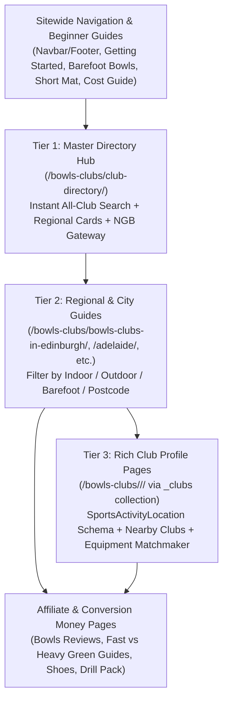

# Bowls Club Directory — Architecture, UX & SEO Master Plan (`jackhighbowls.com`)

## 1. Strategic Decision: City Pages vs. Individual Club Pages

### 1.1 Should We Keep or Delete the 2 Existing City Pages?
**Verdict: Keep and upgrade them — do NOT delete them.**
- **How users search**: 70–80% of local discovery traffic searches by **location + activity** (`"lawn bowls clubs in Edinburgh"`, `"barefoot bowls Adelaide"`, `"indoor bowls clubs near me"`, `"crown green bowls Yorkshire"`) before they ever know a specific club's name. City and regional pages are the only page type that can rank for those plural local-intent queries.
- **Preserving 4+ years of URL age**: [`_posts/2022-05-02-bowls-clubs-in-edinburgh.md`](../_posts/2022-05-02-bowls-clubs-in-edinburgh.md) and [`_posts/2022-05-02-bowls-clubs-in-adelaide-south-australia.md`](../_posts/2022-05-02-bowls-clubs-in-adelaide-south-australia.md) have been indexed since May 2022. They underperformed not because city pages are the wrong model, but because they had **zero internal links**, **empty meta descriptions**, and **incomplete A–E truncated club lists**.
- **Why having "only 2 city pages" feels broken today**: [`_posts/2022-06-01-club-directory.md`](../_posts/2022-06-01-club-directory.md) currently displays empty `<h2>` headings for *England*, *Wales*, *Ireland*, and *New Zealand* with only two links on the entire page. Fix the hub page so it never shows empty sections and immediately routes any visitor to a club via an interactive search bar + official National Governing Body (NGB) finders for regions not yet covered.

---

### 1.2 Is It Worth Having a Dedicated Page for Each Club?
**Verdict: Yes — using a Tiered "Rich Profile" Collection (`_clubs/`), NOT thin stub pages.**

| Approach | SEO Benefit | UX Benefit | Risk / Downside |
| :--- | :--- | :--- | :--- |
| **Option 1: City Pages Only** (No club pages) | Strong for `"bowls clubs in [city]"` queries; concentrates link equity into fewer URLs. | Fast filtering on a single city page; one click out to the club's external website or Google Maps. | Misses long-tail searches for individual club names (`"[Club Name] barefoot bowls"`, `"[Club Name] indoor rinks"`, `"[Club Name] membership"`). |
| **Option 2: Naive Page for Every Club** (Thin 50-word address stubs) | Poor. Google's Helpful Content & Scaled Content systems penalize thin directory stubs that merely duplicate Google Maps. | Frustrating extra click if the club page only repeats the address already shown on the city card. | **High SEO risk**: Dilutes sitewide crawl budget and topical authority across equipment review money pages. |
| **Option 3: 3-Tier Hybrid Architecture (Recommended)** | **Maximum SEO upside**: City pages capture `"bowls clubs in [city]"` + rich individual Club Profile Pages capture `"[Club Name]"` entity searches where ~45% of bowls clubs have dead HTTP sites or Facebook-only pages. | Users can filter instantly on the Hub/City page *or* click **"View Club Profile →"** for deep facility specs, green speeds, beginner/barefoot info, and nearby alternatives. | Requires structured YAML fields so every generated club page has genuine **Information Gain** (400+ words of structured utility). |

#### Why Individual Club Pages Work Uniquely Well in Lawn Bowls
Unlike restaurants or gyms (where official sites and TripAdvisor dominate), nearly half of local lawn bowls clubs have outdated HTTP websites (e.g., `http://www.ee.ed.ac.uk/~adr/ckbchome.htm`), Facebook-only pages, or no website at all. When a newcomer searches `"[Club Name] Edinburgh"` or `"[Club Name] barefoot bowls"`, a clean, mobile-friendly Jack High Bowls profile page with `SportsActivityLocation` schema, surface types, beginner roll-up info, and nearby clubs can rank in the top 3 results while funnelling readers directly into our beginner buying guides.

---

## 2. The 3-Tier Directory Architecture (SEO + UX Blueprint)



### Tier 1: Master Club Directory Hub (`/bowls-clubs/club-directory/`)
- **Target Keywords**: `lawn bowls club directory`, `find a bowls club near me`, `indoor and outdoor bowls clubs UK & Australia`.
- **User Experience**:
  1. **Master Instant Club Search & Filter**: Searches across all clubs in `_data/clubs/*.yml` by club name, city, suburb, postcode, or surface (`Indoor Carpet`, `Outdoor Grass`, `Outdoor Synthetic`, `Crown Green`, `Barefoot / Social`).
  2. **Featured City & Regional Guides**: Visual cards linking to completed city guides (Edinburgh, Adelaide, and Phase 2/3 UK & AU hubs) with live club counts and surface breakdowns.
  3. **Official Governing Body Finder Table (Zero Dead Ends)**: Direct links to Bowls England, EIBA (Indoor), BCGBA (Crown Green), ESMBA (Short Mat), Bowls Scotland, Bowls Wales, Bowls Australia, and Bowls NZ club finders for towns we haven't built a dedicated guide for yet.
  4. **First-Timer's Guide to Visiting a Club**: Practical E-E-A-T advice on open days, borrowing bowls, flat-soled shoes, and membership costs.

### Tier 2: Regional & City Hub Pages (`/bowls-clubs/bowls-clubs-in-<region>/`)
- **Target Keywords**: `bowls clubs in [city]`, `indoor bowls [city]`, `barefoot bowls [city]`, `crown green bowls [region]`.
- **User Experience**:
  1. **Regional Overview & Quick Picks**: Best clubs in the city for *Indoor Winter Bowls*, *Casual / Barefoot Bowls*, and *Beginners & Coaching*.
  2. **Interactive Filter Bar + Scannable Card Grid**: Filter pills (`All`, `Indoor`, `Outdoor`, `Beginner / Barefoot Friendly`) + live suburb/postcode search.
  3. **Dual-Action Club Cards**: Each card displays the club's suburb, postcode badge, surface badges, beginner/social tags, and editorial summary, with two clear actions:
     - **Primary internal link**: `"View Club Profile & Green Guide →"` (links to the Tier 3 `/bowls-clubs/<city>/<club-slug>/` page when `profile_page: true`).
     - **Direct utility links**: `"Google Maps ↗"` and `"Club Website ↗"` so users in a hurry never feel trapped in click-loops.
  4. **Local Green Conditions & Best Bowls Section**: Connects local green speeds (e.g., 10–13s Scottish grass vs. 15–18s Adelaide synthetic/couch) directly to recommended bowl models and reviews.

### Tier 3: Individual Club Profile Pages (`/bowls-clubs/<city>/<club-slug>/`)
- **Target Keywords**: `[Club Name]`, `[Club Name] membership`, `[Club Name] barefoot bowls / night owls`, `[Club Name] address & green type`.
- **How It Works in Jekyll**:
  - Backed by a Jekyll collection (`collections.clubs` in `_config.yml` with permalink `/bowls-clubs/:city/:title/`) synced from `_data/clubs/<region>.yml` via a lightweight generator script (`tools/generate_club_pages.py`) so you only ever edit the YAML data file.
  - **Quality Gate (`profile_page: true`)**: A standalone page is only generated/indexed when a club has rich metadata, guaranteeing zero thin doorway pages.
- **5 Mandatory Modules on Every Club Profile Page (Ensuring High Information Gain)**:
  1. **Facility & Surface Fact Box**: Address, postcode, area, interactive/static Google Maps directions button, verified website/social link, playing surfaces (`Outdoor Grass`, `Indoor Carpet`, `Synthetic`, `Crown Green`), and playing season (April–Sept outdoor vs. Oct–April indoor vs. year-round).
  2. **Beginner, Casual & Social Play Guide**: Explicit badges and notes on whether the club offers *Beginner Taster Sessions*, *Loan Bowls*, *Barefoot Bowls / Night Owls*, *Clubhouse Bar / Function Hire*, and *Wheelchair Access*.
  3. **Dynamic "Best Bowls & Shoes for [Club Name]" Matchmaker**: Automatically renders tailored advice based on the club's `surfaces` and `country`:
     - *If `Indoor Carpet`*: Recommends narrow-to-mid bias bowls ([Best Bowls for Indoors](/guide/best-lawn-bowls-for-indoors/), Taylor Vector VS, Henselite Tiger II).
     - *If UK `Outdoor Grass`*: Recommends mid-to-wide drawing bowls ([Taylor Ace](/review/bowls/taylor-ace-review/), [Drakes Pride Professional](/review/bowls/drakes-pride-professional-review/)).
     - *If AU `Outdoor Grass / Synthetic / Covered Dome`*: Recommends fast-green models ([Best Bowls for Fast Greens](/guide/best-lawn-bowls-for-fast-greens/), [Henselite Tiger](/review/bowls/henselite-tiger-lawn-bowls-review/), [Aero Groove](/review/bowls/aero-groove-lawn-bowls-review/)).
     - *Footwear & Sizing*: Links to [Lawn Bowls Dress Code](/help/lawn-bowls-dress-code/) and [Bowl Size Guide](/help/what-size-lawn-bowl-should-i-use/).
  4. **"Nearby Bowls Clubs in [Area / Postcode]" Cross-Links**: Automatically lists 3–4 neighbouring clubs from the same `area` or postcode prefix in `site.data.clubs[page.city]`, helping users compare nearby options and building dense internal link clusters.
  5. **Structured Data (`SportsActivityLocation` + `FAQPage` + `BreadcrumbList`)**:
     - `BreadcrumbList`: `Home` → `Club Directory` → `Bowls Clubs in [City]` → `[Club Name]`.
     - `SportsActivityLocation`: Includes `name`, `address` (`PostalAddress` with `streetAddress`, `addressLocality`, `postalCode`, `addressCountry`), `url`, `sameAs` (official club site), and `publicAccess`.

---

## 3. Data Schema (`_data/clubs/<region>.yml`)

A single YAML source of truth per region powers **all three tiers** (Master Hub search, City Guide cards, and Individual Club Profile Pages):

```yaml
- slug: "bainfield-bowling-club"
  name: "Bainfield Bowling Club"
  city: "edinburgh"
  city_name: "Edinburgh"
  country: "Scotland"
  country_code: "GB"
  area: "West Edinburgh (Hutchison / Gorgie)"
  address: "34 Hutchison Crossway, Edinburgh"
  postcode: "EH14 1RU"
  surfaces:
    - "Indoor Carpet"
    - "Outdoor Grass"
  formats:
    - "Flat Green"
    - "Indoor"
  season: "Year-round (Outdoor Apr–Sep, Indoor Sep–Apr)"
  rinks_info: "8-rink indoor stadium plus outdoor grass greens"
  beginner_friendly: true
  barefoot_social: true
  loan_bowls: true
  bar_clubhouse: true
  website: "https://www.bainfieldbowlingclub.co.uk/"
  maps_query: "Bainfield+Bowling+Club+34+Hutchison+Crossway+Edinburgh+EH14+1RU"
  profile_page: true
  summary: "One of Edinburgh's premier year-round venues, featuring both an 8-rink indoor stadium for winter play and traditional outdoor grass greens."
  about: >
    Located in West Edinburgh near Gorgie and Slateford, Bainfield Bowling Club is one of the few clubs in the Lothian region offering both outdoor summer grass greens and a dedicated 8-rink indoor bowling stadium. This makes it an ideal hub for bowlers looking to play through the Scottish winter as well as newcomers attending taster sessions.
```

---

## 4. Technical & SEO Fixes Required on Existing Pages

| # | Current Issue | Technical Fix | SEO & UX Impact |
| :--- | :--- | :--- | :--- |
| **1** | **Complete Orphan Status (0 Internal Links)** | Add `/bowls-clubs/club-directory/` to [`_includes/footer-nav.html`](../_includes/footer-nav.html), [`getting-started.md`](../getting-started.md), [`2019-08-06-barefoot-bowls.md`](../_posts/2019-08-06-barefoot-bowls.md), [`2018-03-01-guide-to-short-mat-bowls.md`](../_posts/2018-03-01-guide-to-short-mat-bowls.md), and beginner cost/tips posts. | Passes internal PageRank from cornerstone pages and gives human readers a clear discovery path. |
| **2** | **Broken Breadcrumb Hierarchy** | Update [`_includes/breadcrumbs.html`](../_includes/breadcrumbs.html) and [`_includes/head.html`](../_includes/head.html) so `bowls-clubs` posts and `_clubs` collection pages nest cleanly under `Home > Club Directory > [City] > [Club]`. | Establishes a semantic topical silo in `BreadcrumbList` JSON-LD. |
| **3** | **Empty Meta Descriptions & Truncated Lists** | Add compelling 150-char `description` frontmatter; expand Edinburgh from 22 (A–E only) to 35+ A–Z clubs; expand Adelaide from 7 to 25+ metro clubs. | Fixes SERP CTR and satisfies Helpful Content completeness. |
| **4** | **Unstyled WordPress Gutenberg Markup** | Replace `<div class="wp-block-columns">` with `_includes/club-directory-list.html` and `_sass/_club-directory.scss` using brand colours (`#1F2B5F`, `#C89B3C`, `#f8f9fa`). | Mobile-friendly cards with instant surface/postcode filtering. |
| **5** | **Mismatched Review Callout & Missing Schema** | Hide `.review-methodology-callout` on `bowls-clubs` pages in [`_layouts/post.html`](../_layouts/post.html); output `ItemList` on city pages and `SportsActivityLocation` on club profile pages in [`_includes/head.html`](../_includes/head.html). | Aligns page UI with local directory intent and unlocks rich results. |

---

## 5. Phased Implementation Roadmap

### Phase 1: Architecture, Master Hub & Existing City Overhaul (Immediate Priority)

| ID | Task | Target Files |
| :--- | :--- | :--- |
| **CD-01** | **Template, Breadcrumb, Schema & `_clubs` Collection Setup**<br>Configure `collections.clubs` in `_config.yml`; update `breadcrumbs.html`, `head.html` (`ItemList` + `SportsActivityLocation` + 4-level breadcrumbs), `sitemap.xml` (include `site.clubs`), and `_layouts/post.html` (hide review callout on directory pages); create `_layouts/club.html`. | `_config.yml`, [`_includes/breadcrumbs.html`](../_includes/breadcrumbs.html), [`_includes/head.html`](../_includes/head.html), [`_layouts/post.html`](../_layouts/post.html), `_layouts/club.html`, [`sitemap.xml`](../sitemap.xml) |
| **CD-02** | **Reusable Club Card Grid, Instant Filter & Club Page Generator**<br>Build `_includes/club-directory-list.html`, `_sass/_club-directory.scss`, and `assets/js/club-directory-filter.js` (filter by Indoor/Outdoor/Barefoot + postcode/name search, linking cards to `"View Club Profile →"` + Maps + Website); add `tools/generate_club_pages.py` to generate `_clubs/<city>/<slug>.md` from `_data/clubs/*.yml`. | `_includes/club-directory-list.html`, `_sass/_club-directory.scss`, `assets/js/club-directory-filter.js`, `tools/generate_club_pages.py` |
| **CD-03** | **Rebuild the Master Club Directory Hub (`/bowls-clubs/club-directory/`)**<br>Remove empty country headings; add an all-region club finder, Featured City Guides cards, Official NGB Club Finder directory table (UK, AU, NZ, US, CA), and a "How to Choose & Join Your First Bowls Club" guide + FAQs. | [`_posts/2022-06-01-club-directory.md`](../_posts/2022-06-01-club-directory.md) |
| **CD-04** | **Complete Edinburgh Bowls Clubs Guide + Rich Club Profiles**<br>Create `_data/clubs/edinburgh.yml` (35+ A–Z clubs across Edinburgh & Lothian, fixing the A–E cutoff and dead HTTP links), generate `_clubs/edinburgh/*.md` profile pages, and upgrade `2022-05-02-bowls-clubs-in-edinburgh.md` with Scottish green-speed equipment advice. | `_data/clubs/edinburgh.yml`, `_clubs/edinburgh/*.md`, [`_posts/2022-05-02-bowls-clubs-in-edinburgh.md`](../_posts/2022-05-02-bowls-clubs-in-edinburgh.md) |
| **CD-05** | **Complete Adelaide Bowls Clubs Guide + Rich Club Profiles**<br>Create `_data/clubs/adelaide.yml` (25+ metro Adelaide clubs with Night Owls / Barefoot Bowls & Covered Dome tags), generate `_clubs/adelaide/*.md` profile pages, and upgrade `2022-05-02-bowls-clubs-in-adelaide-south-australia.md` with fast-green equipment advice. | `_data/clubs/adelaide.yml`, `_clubs/adelaide/*.md`, [`_posts/2022-05-02-bowls-clubs-in-adelaide-south-australia.md`](../_posts/2022-05-02-bowls-clubs-in-adelaide-south-australia.md) |
| **CD-06** | **Internal Linking Flywheel from Cornerstone Hubs & Guides**<br>Link to `/bowls-clubs/club-directory/` and city/club pages from `getting-started.md`, `_includes/footer-nav.html`, `2019-08-06-barefoot-bowls.md`, `2018-03-01-guide-to-short-mat-bowls.md`, and `2020-06-16-how-much-does-lawn-bowls-cost.md`. | [`getting-started.md`](../getting-started.md), [`_includes/footer-nav.html`](../_includes/footer-nav.html), `_posts/*.md` |

### Phase 2: UK High-Intent Regional Expansion (`CD-07`)
Roll out regional city hubs + individual club profile pages targeting high-volume UK search modifiers:
1. **Glasgow & West of Scotland** (Outdoor Grass & Indoor Centres)
2. **London** (Casual Park Greens, Historic Clubs & Winter Indoor Rinks)
3. **Bristol, Bath, Somerset & Wiltshire** (Outdoor, Indoor & Short Mat Hubs)
4. **Greater Manchester & Lancashire** (Crown Green vs. Flat Green & Indoor Guide)
5. **Yorkshire** (Crown Green, Flat Green & Indoor Stadiums)

### Phase 3: Australian & NZ Metro Expansion (`CD-08`)
Roll out metro hubs + club profiles targeting dual intent (*"lawn bowls clubs in [city]"* + *"barefoot bowls [city]"*):
1. **Melbourne** (Barefoot Bowls & Pennant Clubs)
2. **Sydney** (Coastal, Inner West & Premier Clubs)
3. **Brisbane & Gold Coast** (Covered Domes & Social Clubs)
4. **Perth** (Metro & Coastal Clubs)
5. **Auckland** (New Zealand Metro Hubs)
