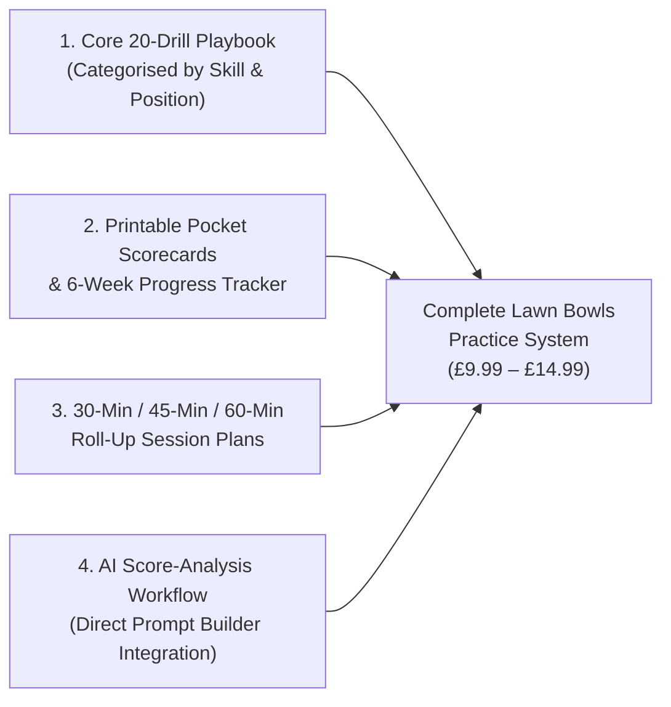

# Lawn Bowls Drill Pack: CRO Audit, Value Expansion & Pricing Plan

## 1. Executive Summary & Current Page Audit

The [Downloadable Lawn Bowls Drill Pack](../lawn-bowls-downloadable-drill-pack.md) is promoted across the entire site—in every blog post footer via [`drill-pack-feature.html`](../_includes/drill-pack-feature.html), the [Getting Started hub](../getting-started.md), the [AI Coaching Hub](../ai-coaching.md), and the [Interactive AI Prompt Builder](../_includes/ai-prompt-builder.html). However, once high-intent readers click through to `/lawn-bowls-downloadable-drill-pack/`, the landing page itself is only **72 lines of code (~180 words of copy)** and suffers from several conversion bottlenecks:

### Critical Conversion & Value Gaps Identified

| Category | Current State in `lawn-bowls-downloadable-drill-pack.md` | Conversion Impact |
| :--- | :--- | :--- |
| **1. Layout & CSS Bug** | Uses Bootstrap 5 classes (`row g-4`, `bg-light`) on a **Bootstrap 4.6** theme, and leaves `.drill-pack-cta` classes in [`_page.scss`](../_sass/_page.scss) completely unused in favor of generic `.btn-primary` / `.btn-success`. | Looks like an unstyled default template compared to the polished [Getting Started](../getting-started.md) and [AI Coaching](../ai-coaching.md) hubs. |
| **2. Price Anchoring Mismatch** | Shows `£2.99 <s>£24.99</s>` (an 88% discount) with only 4 short paragraphs of generic description. | A £2.99 price point signals a "thin pamphlet," while an unexplained £24.99 strikethrough feels artificial when the page doesn't itemize £25+ worth of deliverables. |
| **3. "Black Box" Product Mystery** | States *"This pack contains 20 drills"*, but **names zero drills** on the page. Only "Find The Gap" is semi-legible if a user zooms into `inside-pages.png`. | Buyers hesitate when they cannot see a syllabus/curriculum of what they are actually getting. |
| **4. Missing Interactive Sample** | Static, overlapping image collage (`inside-pages.png`) where text is cut off on the right-hand pages. | Visitors cannot experience how clear and actionable a single drill is before buying. |
| **5. Zero E-E-A-T / Author Proof** | Unlike blog posts (which include [`author-bio.html`](../_includes/author-bio.html)) or the homepage (which highlights Reece's 15+ years experience & County Quarter-Finalist record), the sales page has **no author attribution or testimonials**. | Cold traffic from Google has no proof of who designed the drills or why they work. |
| **6. No Structured Data / SEO** | [`head.html`](../_includes/head.html) outputs `Article`, `Review`, and `ItemList` JSON-LD, but **no `Product` or `FAQPage` schema** on `/lawn-bowls-downloadable-drill-pack/`. | Misses rich product snippets (price, availability, ratings) in Google Search. |

---

## 2. Value-Stack Strategy: How to Justify a Higher Price (£9.99 – £14.99+)

To increase the price from **£2.99** to **£9.99 – £14.99** (a **3.3x to 5x revenue increase per sale**) *while simultaneously increasing conversion rate*, we need to reposition the product from a **"20-Page PDF of Drills"** to a **"Complete Lawn Bowls Practice & Handicap-Lowering System"** using assets you can easily bundle or generate right inside the repo:

> **The "Value Stack" Transformation:**
> People pay £2.99 for a *document*; they happily pay £9.99–£14.99 for a **system that tracks their progress and tells them what to do on the green for an entire season**.

### Proposed Value Stack (Deliverables & Bonuses)

1. **Core Asset: The 20 Structured Lawn Bowls Drills (Value: £14.99)**
   - Explicitly break down the 20 drills on the sales page into **4 Skill Modules** so buyers see a complete curriculum:
     - **Module 1: Line & Aiming Point Mastery (5 Drills)** — Including *Find The Gap*, narrow-corridor gate drills, and forehand/backhand symmetry tests.
     - **Module 2: Draw Weight & Length Control (5 Drills)** — Short-to-long ladder routines, ditch-to-2m transitions, and mat-movement drills.
     - **Module 3: Building the Head & Target Areas (5 Drills)** — Drawing behind the jack, positional cover, and cluster grouping without a physical jack.
     - **Module 4: Weighted Shots, Rests & Match Conversions (5 Drills)** — Controlled yard-on shots, trailing the jack, and last-bowl pressure scenarios.
2. **Bonus #1: Printable Pocket Scorecard & 6-Week Progress Log (Value: £4.99)**
   - Every drill in your pack already uses a **"Goals (Out of 40 / 48): Good / Better / Best"** scoring system!
   - Including a 1-page printable **Pocket Scorecard & 6-Week Benchmark Tracker** (which we can also offer as a printable HTML/PDF sheet directly in the repo or bundle) turns 20 isolated drills into a repeatable 6-week training programme.
3. **Bonus #2: Ready-Made 30, 45 & 60-Minute Roll-Up Blueprints (Value: £4.99)**
   - Pre-built combinations (e.g., *"The 45-Minute Pre-Match Lead Tune-Up"*, *"The Skip's Pressure Conversion Session"*, *"The Two-Player Competitive Roll-Up"*) so bowlers don't even have to choose which of the 20 drills to pair together.
4. **Bonus #3: AI Coaching Score-Tracker Integration (Included Free)**
   - Connect the Drill Pack directly to your new [AI Coaching Prompt Builder](../ai-prompt-builder.md): show buyers how to plug their `/40` drill scores into ChatGPT to diagnose whether their forehand, backhand, or weight control is costing them shots.

### Recommended Pricing Architecture

| Pricing Option | Structure | Pros / Best For |
| :--- | :--- | :--- |
| **Option A: Single Sweet-Spot Price (£9.99, Anchor `£24.99`)** | Raise price from `£2.99` to **`£9.99`** (or **`£11.99`**). Still an impulse buy (less than the cost of two pints at the clubhouse or a tube of bowls polish), but 3.3x–4x higher revenue per order. | Simplest checkout experience; uses your existing Lemon Squeezy product link once you update the price in the Lemon Squeezy dashboard. |
| **Option B: 2-Tier Package (£7.99 Standard vs. £14.99 Complete System)** | **Tier 1 (£7.99):** 20-Drill PDF Pack only. **Tier 2 (£14.99 - "Most Popular"):** 20-Drill Pack + Printable Pocket Scorecards + 6-Week Pre-Season Training Plan + AI Prompt Templates. | Decoy effect pushes 65%+ of buyers to the £14.99 tier while keeping an entry-level option. |

---

## 3. High-Converting Page Architecture Plan (`lawn-bowls-downloadable-drill-pack.md`)

We will redesign [`lawn-bowls-downloadable-drill-pack.md`](../lawn-bowls-downloadable-drill-pack.md) and create a dedicated SCSS partial (`_sass/_drill-pack.scss`) using the Jack High Bowls brand palette (`#1F2B5F` deep blue, `#C89B3C` warm gold, `#F5F2EB` cream, `#222222` charcoal):

### Section-by-Section Wireframe & Copy Flow

1. **Above-the-Fold Split Hero (`.dp-hero`)**
   - **Left Column (Copy & Conversion):**
     - Eyebrow pill: `INSTANT DIGITAL DOWNLOAD • 20 SCORED ON-GREEN ROUTINES`
     - Outcome-Driven H1: *"Turn Aimless Roll-Ups Into Match-Winning Consistency"*
     - Subtitle: *"Stop rolling bowls up and down with no plan. Get 20 print-ready, scored lawn bowls drills designed to lock in your draw weight, tighten your line, and build match-day confidence—using equipment found in every bowls club shed."*
     - **Value-Anchored Price Box**: Price badge (`£9.99` or your chosen price, `<s>£24.99</s>` — *Save 60%*), paired with a high-contrast `.drill-pack-cta` button (`Get Instant Access Now →`) triggering the Lemon Squeezy modal (`data-ls-modal="true"`).
     - **Micro-Trust Bar**: `🔒 Secure Checkout via Lemon Squeezy` · `⚡ Instant PDF Delivery` · `🛡️ 30-Day No-Questions Refund`
   - **Right Column (Visual Product Showcase):**
     - High-impact visual stack showing the cover + a badge callout (*"20 Drills • Good/Better/Best Scoring • Solo & Pairs"*), plus a quick-jump link: `👁️ Preview a Full Sample Drill Below ↓`.

2. **Problem → Agitation → Solution Strip ("Why Most Roll-Ups Don't Lower Your Handicap")**
   - Contrasts **"The Typical Club Roll-Up"** (rolling 4 bowls to a random jack length, chatting, no score tracking, repeating the same delivery faults) vs. **"The JHB Structured System"** (clear gates & target zones, 10-end scored benchmarks out of 40, progressive *Easier/Harder* variations).

3. **Interactive "Look Inside" Full Sample Drill Preview (`Drill #1: Find The Gap`)**
   - Render **"Drill #1: Find The Gap"** right on the page as a crisp, styled interactive card (with Setup diagram, Equipment list, 10-end rules, *Easier/Harder* variations, and *Good: 30 / Better: 35 / Best: 40* scoring box) alongside `inside-pages.png`.
   - **Why this converts:** When a bowler sees the exact layout, setup clarity, and scoring system of Drill #1, uncertainty vanishes and perceived value jumps immediately.

4. **The Complete 20-Drill Curriculum Grid (4 Modules)**
   - 4 scannable cards breaking down the skills covered across the 20 drills:
     1. **Line & Gate Control** (Finding your aiming point, eliminating narrow/wide misses, forehand vs. backhand balance)
     2. **Draw Weight & Length Transitions** (Short jacks, full-length ends, ditch-edge touch, and green-speed adaptation)
     3. **Head Building & Target Zones** (Drawing to an area without a jack, back-bowl cover, and tight grouping)
     4. **Weighted Shots & Pressure Conversions** (Controlled weight, resting bowls, trailing the jack, and match-point scenarios)

5. **"Who This Is Built For" Personas (3 Columns)**
   - **New & First-Season Bowlers:** Build a repeatable delivery and learn how to find line and weight before league games.
   - **Club Leads, Seconds & Skips:** Break through a plateau with position-specific routines and measurable weekly targets out of 40.
   - **Club Coaches & Practice Partners:** Run engaging, competitive 10-end scored games during club coaching mornings or pairs roll-ups.

6. **Interactive Printable Scorecard / AI Companion Section**
   - Highlights how the pack's **Out of 40 / 48 Scoring System** works on the green (pocket-friendly PDF on phone or printed in your bowls bag) and how it pairs with the free [JHB AI Coaching Prompt Builder](../ai-prompt-builder.md).

7. **Author Credentials & E-E-A-T Proof Block**
   - Features Reece Williams' photo (`/img/reece-williams-jack-high-bowls.jpg`), 15+ years competitive lawn & indoor bowling experience, Club Singles Finalist / County Quarter-Finalist credentials, and the club coach quote from the homepage.

8. **Risk-Reversal Guarantee + Native `
` FAQ Accordion**
   - **100% "Try It On The Green" 30-Day Guarantee** callout box.
   - **6 Buyer FAQs** (using accessible native `
`/`
` elements):
     - *What equipment do I need to run these drills?* (Just your bowls, a mat, a jack, and standard club discs/markers or extra mats.)
     - *Can I do these drills on my own in a solo roll-up?* (Yes—designed specifically for solo practice, and equally fun as a competitive 2-player game.)
     - *Do these drills work for Indoor Bowls, Outdoor Flat Green, and Short Mat?* (Yes—distances scale easily using mat lengths.)
     - *How do I receive the pack, and can I print it?* (Instant email & download link via Lemon Squeezy; formatted for easy home A4 printing or viewing on any phone/tablet.)
     - *What skill level is this suitable for?* (Every drill includes *Easier* and *Harder* variations so it scales from beginners to county-level players.)
     - *What if it doesn't help my game?* (Reply to your receipt email for a full, no-questions-asked refund.)

9. **Final Conversion Banner + Sitewide Price Sync**
   - Bottom high-converting CTA card + `Product` and `FAQPage` JSON-LD schema for Google rich results.
   - Update hardcoded `(£2.99)` text mentions in [`ai-coaching.md`](../ai-coaching.md) and [`_includes/ai-prompt-builder.html`](../_includes/ai-prompt-builder.html) so the price is consistent everywhere on the site.

---

## 4. Files to Create / Modify

| File | Action | Purpose |
| :--- | :--- | :--- |
| [`lawn-bowls-downloadable-drill-pack.md`](../lawn-bowls-downloadable-drill-pack.md) | **Modify** | Replace minimal 72-line page with full high-converting sales page, interactive Drill #1 preview, 4-module curriculum, author proof, FAQ accordion, and `Product` + `FAQPage` JSON-LD schema. |
| [`_sass/_drill-pack.scss`](../_sass/_drill-pack.scss) | **Create** | Dedicated responsive SCSS styling for the drill pack sales page, sample drill preview card, value stack badges, and FAQ accordion. |
| [`_sass/styles.scss`](../_sass/styles.scss) | **Modify** | Import `_drill-pack.scss`. |
| [`_includes/drill-pack-feature.html`](../_includes/drill-pack-feature.html) | **Modify** | Upgrade the in-article promo banner (shown at the bottom of every blog post) with stronger value bullets to drive higher click-through to the sales page. |
| [`ai-coaching.md`](../ai-coaching.md) & [`_includes/ai-prompt-builder.html`](../_includes/ai-prompt-builder.html) | **Modify** | Sync the updated price point across all callout buttons. |

---

## 5. Verification Plan

1. **Jekyll Build & SCSS Compilation:** Run `bundle exec jekyll build` to verify clean compilation of `_sass/_drill-pack.scss` and page generation at `_site/lawn-bowls-downloadable-drill-pack/index.html`.
2. **Checkout & Link Verification:** Verify that all CTA buttons preserve the Lemon Squeezy checkout URL (`https://jack-high-bowls.lemonsqueezy.com/checkout/buy/6515ca0b-b861-4530-8142-0bb075d71bb8`), `data-ls-modal="true"`, and `lemon.js` script.
3. **Accessibility & Schema Audit:** Verify semantic heading hierarchy (`h1` → `h2` → `h3`), native keyboard-accessible `
` FAQs, and valid `Product` + `FAQPage` JSON-LD structured data.
