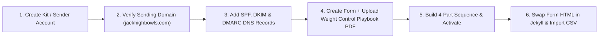

# Mailchimp Migration (2,085 Subscribers) & 4-Part Intro Sequence Plan

## 1. Executive Summary & Provider Selection

With **2,085 subscribers**, you have outgrown Mailchimp's free tier (which is now capped at 250–500 contacts and locks multi-step automations behind paid plans costing ~$45–$60/month at your list size).

Most email service providers (ESPs) have shrunk their free tiers below 1,000 contacts, or they block automated sequences on free plans. Below is how the current market stacks up specifically for **2,085+ subscribers** AND a **4-part automated intro sequence** at **$0/month**:

| Provider | Free Subscriber Cap | Free Monthly Sends | Automated 4-Part Sequence on Free Tier? | Verdict for Jack High Bowls |
| :--- | :--- | :--- | :--- | :--- |
| **Kit (formerly ConvertKit)** *(Recommended)* | **10,000 subscribers** | **Unlimited** | **Yes** — Free *Newsletter Plan* includes **1 Visual Automation + 1 Email Sequence** (with unlimited emails inside that sequence). | **Best Long-Term Choice.** Gives you nearly **5x growth headroom** (from 2,085 to 10,000 subs) at $0/mo, native PDF lead-magnet delivery, and 1 full multi-email welcome sequence. |
| **Sender.net** *(Runner-Up)* | **2,500 subscribers** | **15,000 emails/mo** | **Yes** — Includes **unlimited automation workflows** on the Free Forever tier. | **Best if you want multiple separate sequences right now**, though you only have ~415 subscribers of buffer before hitting the 2,500 cap (unless you clean cold contacts first). |
| **EmailOctopus** | **2,500 subscribers** | **10,000 emails/mo** | **Yes** — Up to 3 automations (max 5 steps per workflow). | Solid backup, but 10,000 monthly sends only allows ~4 full-list newsletters per month at 2,085 subs. |
| **Brevo** | 100,000 contacts | **300 emails/day cap** | Capped at **2,000 contacts total** in automation. | **Avoid.** 2,085 exceeds their 2,000 automation cap, and the 300/day send limit takes 7 days to send one newsletter. |
| **MailerLite / Beehiiv** | 250–500 (ML) / 2,500 (Beehiiv) | Varies | Beehiiv locks multi-step welcome sequences behind paid plans; MailerLite caps at 250–500 subs. | **Avoid** for a free 2,085-subscriber automated setup. |

> [!TIP]
> **Recommendation: Choose Kit (Newsletter Free Plan) — or Sender.net if you want multiple sequences**
> - Choose **Kit (Free Newsletter Plan)** if you want **zero cost up to 10,000 subscribers**, unlimited newsletter broadcasts, automatic PDF delivery for your *Weight Control Playbook*, and **one 4-part automated welcome sequence** that every new subscriber flows through.
> - Choose **Sender.net (Free Forever)** if you want multiple branching workflows right away and are happy to prune ~300–400 inactive Mailchimp contacts so you stay comfortably below the 2,500-subscriber limit.

---

## 2. Phase 1: Pre-Migration List Hygiene (Do This Before Exporting)

Migrating all 2,085 contacts blindly can trigger spam filters on a new provider and eat into your subscriber limits with dead addresses.

1. **Export Full Audience from Mailchimp:**
   - Go to **Audience → All contacts → Export Audience** in Mailchimp. Download the ZIP file containing your Subscribed, Unsubscribed, and Cleaned CSVs.
2. **Segment & Prune Cold Contacts (Optional but Recommended):**
   - Identify subscribers who have been on the list for **6+ months with a 0% open rate** (or `Member Rating == 1`).
   - Send 1 final "Still working on your bowls game?" re-engagement email from Mailchimp before closing it, or archive completely dead/bounced contacts so you only import active bowlers (typically ~1,500–1,800 contacts).
3. **Preserve Unsubscribes:**
   - Never import `Unsubscribed` or `Cleaned` CSV files into your new active list (or import them strictly into the new provider's **Suppression/Blocklist** so you never accidentally email them again).

---

## 3. Phase 2: Account, DNS & Deliverability Setup

Bowlers frequently use older ISP inbox providers (`@btinternet.com`, `@sky.com`, `@talktalk.net`, `@yahoo.co.uk`, `@gmail.com`) that strictly enforce sender authentication.



1. **Sender Identity:**
   - Set your "From" name to `Reece at Jack High Bowls` and your sending address to `reece@jackhighbowls.com` (never send marketing broadcasts from a free `@gmail.com` address—Yahoo and Gmail will block bulk sends).
2. **Verify `jackhighbowls.com` DNS Records:**
   - In your domain DNS manager, add the **DKIM** (`CNAME` or `TXT`) and **SPF** records provided by Kit or Sender.net.
   - Ensure you have a **DMARC** record at `_dmarc.jackhighbowls.com`:
     ```txt
     v=DMARC1; p=none; rua=mailto:reece@jackhighbowls.com
     ```
3. **Upload the Lead Magnet:**
   - Your current modal ([`_includes/newsletter-modal.html`](file:///home/reecewilliams8/dev%20work/jhb/_includes/newsletter-modal.html#L18-L21)) promises the **Weight Control Playbook** (*"ten quick wins to sharpen your draw weight today"*).
   - Upload this PDF directly to Kit's **Incentive Email** (or link it in Email 1 of the sequence) so new subscribers receive it within 60 seconds of signing up.

---

## 4. Phase 3: Technical Changes in the Jack High Bowls Repository

Your Jekyll site currently centralizes all newsletter signups into three files. Migrating the codebase takes less than 15 minutes and won't break your existing styling:

### 1. Update [`_includes/mailchimp-form.html`](file:///home/reecewilliams8/dev%20work/jhb/_includes/mailchimp-form.html#L1-L65)
Currently, [`_includes/mailchimp-form.html`](file:///home/reecewilliams8/dev%20work/jhb/_includes/mailchimp-form.html#L1-L65) posts to `https://jackhighbowls.us17.list-manage.com/subscribe/post...` with `name="EMAIL"` and `name="FNAME"`.
- **How we will update it:** Keep your exact `.home-lead__form`, `.form-group`, and `.form-control` classes so the modal and inline forms look identical, but swap the `<form action="...">` URL and input `name` attributes:
  - **For Kit:** `action="https://app.kit.com/forms/YOUR_FORM_ID/subscriptions"`, email input `name="email_address"`, and first name input `name="fields[first_name]"`.
  - **For Sender.net:** Use Sender's embedded HTML form action endpoint and field mappings.

### 2. Verify [`_includes/newsletter-modal.html`](file:///home/reecewilliams8/dev%20work/jhb/_includes/newsletter-modal.html#L1-L32) & [`_includes/lead-magnet-backup.html`](file:///home/reecewilliams8/dev%20work/jhb/_includes/lead-magnet-backup.html#L1-L33)
- Both includes pull in ``—so updating [`_includes/mailchimp-form.html`](file:///home/reecewilliams8/dev%20work/jhb/_includes/mailchimp-form.html) automatically updates the popup modal across all 347 blog posts ([`_layouts/post.html`](file:///home/reecewilliams8/dev%20work/jhb/_layouts/post.html#L176)) and any inline lead magnet blocks.
- **Bonus Conversion Hook:** We can also embed a "Download 1 Free Sample Drill + Get the Weight Control Playbook" capture block on [`lawn-bowls-downloadable-drill-pack.md`](file:///home/reecewilliams8/dev%20work/jhb/lawn-bowls-downloadable-drill-pack.md) so hesitant visitors on the sales page enter the 4-part sequence.

### 3. Update GDPR Disclosures in [`privacy.html`](file:///home/reecewilliams8/dev%20work/jhb/privacy.html#L85-L225)
- Update **Section 3.2 (lines 95–98)**, **Section 6 (line 205)**, and **Section 7 (line 219)** in [`privacy.html`](file:///home/reecewilliams8/dev%20work/jhb/privacy.html#L85-L225) to replace **Mailchimp (The Rocket Science Group LLC / Intuit)** with **Kit (Kit, Inc.)** or **Sender (Sender.net)** as your newsletter data processor.

### 4. Pause Mailchimp Billing (Don't Delete Your Account)
- Once your CSV is imported into the new provider and the new form is live on `jackhighbowls.com`, go to Mailchimp **Account & Billing → Pause or Archive Contacts** so you stop getting billed immediately while retaining historical campaign reports.

---

## 5. Phase 4: The 4-Part Automated Intro Sequence

This 4-part sequence is engineered specifically for **Jack High Bowls**. It fulfills the promised lead magnet, builds personal authority with Reece's coaching philosophy, introduces your free **AI Bowls Coach**, and naturally transitions into pitching the **Downloadable Lawn Bowls Drill Pack**.

### Sequence Architecture & Timing

| Email | Timing | Core Objective | Primary Call-to-Action (CTA) |
| :--- | :--- | :--- | :--- |
| **Email 1** | **Immediate (Day 0)** | Deliver the **Weight Control Playbook** + set expectations + get a micro-reply (boosts inbox deliverability). | Download the Playbook + Reply with biggest bowls struggle |
| **Email 2** | **Day 2 (+48 hours)** | **The "Roll-Up Trap":** Why 90% of club bowlers waste practice time, plus 1 free structured drill with scoring targets. | Try the "3-Length Ladder Drill" + View the AI Coach |
| **Email 3** | **Day 4 (+48 hours)** | **Reading the Green & Equipment:** How bias profiles and green speeds secretly ruin weight control (links to top guides). | Read the Bias & Green Speed Guide + Soft intro to Drill Pack |
| **Email 4** | **Day 7 (+72 hours)** | **The Structured Practice Pitch:** Full breakdown of the **Downloadable Lawn Bowls Drill Pack** & seasonal progression. | Get the Printable Lawn Bowls Drill Pack |

---

### Ready-to-Use Copy for All 4 Emails

#### Email 1: Welcome & Playbook Delivery (Immediate)
- **Subject Line Options:**
  - `Your Weight Control Playbook is inside (+ a quick question)`
  - `Welcome to Jack High Bowls! Here is your playbook`
- **Preview Text:** `Ten quick wins to dial in your draw weight before the mat is even set.`

> Hi {{ subscriber.first_name | default: "there" }},
>
> Welcome to **Jack High Bowls**! I'm Reece, and I'm glad to have you here.
>
> As promised, here is your copy of the **Weight Control Playbook**:
>
> 👉 **[Download Your Weight Control Playbook (PDF)](YOUR_PLAYBOOK_LINK)**
>
> **Why I put this together:**
> In almost every club match I play or watch, the difference between winning and losing isn't who plays the flashiest firing shot—it's who adjusts their draw weight fastest in the first four ends.
>
> Even 18 inches too heavy takes your bowl behind the head where it can't help you, while 18 inches short gives your opponent a free blocker to hides behind.
>
> **Inside the playbook, pay special attention to:**
> 1. **The First-Two-Ends Rule:** How to find the green's true pace without giving away early shots.
> 2. **Fixing the Pendulum:** Why speeding up your backswing ruins your weight consistency (and how to use step length instead).
> 3. **Building Back-Bowls:** Why missing *past* the jack by a foot is ten times better than dropping short.
>
> **Quick question for you (just hit reply):**
> What position do you usually play (Lead, Second, Third, Skip, or Singles), and what's the #1 part of your game you want to sharpen this season?
>
> I read every reply personally, and it helps me send you the best tips for your game.
>
> Good bowling,
>
> **Reece Williams**
> Founder, [Jack High Bowls](https://jackhighbowls.com)

---

#### Email 2: The "Roll-Up Trap" + A Free Scored Drill (Day 2)
- **Subject Line Options:**
  - `Why most "roll-ups" actually make you worse`
  - `Stop rolling jack-to-jack (try this 15-minute drill instead)`
- **Preview Text:** `Here is how to turn a casual 20-minute roll-up into match-winning draw weight.`

> Hi {{ subscriber.first_name | default: "there" }},
>
> Have you ever had a great mid-week roll-up where you couldn't miss the jack—only to step onto the green on Saturday afternoon and feel like you've never held a bowl before?
>
> It happens to almost every bowler, and the culprit is what I call **The Roll-Up Trap**.
>
> When most club players go for a practice roll, they throw the jack to a comfortable medium length, bowl four woods at it on the same hand, walk up the green, and do the exact same thing coming back.
>
> By the third bowl of the end, your body is just groove-adjusting to the previous bowl. **Wait until a real match when the skip moves the mat up and throws a Ditch-to-Ditch long jack—suddenly that "grooved" feel disappears.**
>
> ### Try This Next Time You Practice: The 4-Bowl Length Ladder
> Instead of bowling four woods at one jack, place **three markers** down the rink:
> - **Marker 1:** Short (23–25m)
> - **Marker 2:** Medium (27–28m)
> - **Marker 3:** Full Length (31m+)
>
> **The Rules:**
> - Bowl 1 goes to Marker 1 (Forehand)
> - Bowl 2 goes to Marker 2 (Backhand)
> - Bowl 3 goes to Marker 3 (Forehand)
> - Bowl 4 goes to whichever marker you missed by the furthest distance.
> - **Scoring:** Give yourself **3 points** for finishing within a mat-length behind the marker, **1 point** for mat-length short, and **0 points** for anything outside a yard. Track your score over 6 ends (max 72 points).
>
> That single change forces your brain and body to reset your weight on *every single bowl*—just like a real match.
>
> **Want more tailored practice ideas?**
> You can also test out our free **[AI Lawn Bowls Coach](https://jackhighbowls.com/ai-coaching/)** on the site anytime to build custom training prompts for your specific role.
>
> In two days, I'll share the hidden equipment mistake that makes holding a consistent line twice as hard as it needs to be.
>
> Best,
>
> **Reece Williams**
> [Jack High Bowls](https://jackhighbowls.com)

---

#### Email 3: Equipment, Bias & Reading the Green (Day 4)
- **Subject Line Options:**
  - `Are you fighting your own bowls?`
  - `The hidden reason your draw line breaks down under pressure`
- **Preview Text:** `How bias profiles and green speed work together—and our 3 most-read guides.`

> Hi {{ subscriber.first_name | default: "there" }},
>
> Sometimes a weight or line problem isn't your delivery at all—it's a mismatch between your bowls' bias profile, the green speed, and the shot you're trying to play.
>
> If you're bowling with a wide-drawing model on a fast, windy outdoor rink (or using an ultra-narrow indoor set on a heavy early-season grass green), you end up subconsciously forcing your arm line or over-throwing your weight just to reach the head.
>
> Over the last few years, I've tested dozens of bowls models and written over 300 guides on Jack High Bowls. If you haven't read these three cornerstone guides yet, bookmark them for your next coffee break:
>
> 1. **[How to Choose a Set of Lawn Bowls](https://jackhighbowls.com/guide/how-to-choose-a-set-of-lawn-bowls/)** — How size, grip, and bias profiles match your green speed and playing position.
> 2. **[How to Get Better at Lawn Bowls](https://jackhighbowls.com/help/how-to-get-better-at-lawn-bowls/)** — The core mechanics of a repeatable delivery, from stance to release.
> 3. **[The Ultimate Guide to Lawn Bowls Singles Tactics](https://jackhighbowls.com/help/ultimate-guide-to-lawn-bowls-singles-tactics/)** — How to control the mat, manipulate jack length, and build pressure head-by-head.
>
> **Coming up next:**
> Reading about technique is step one, but having a structured, printable plan in your bowls bag when you step onto the rink is where real improvement happens. In my next email, I'll show you the exact system I use to structure every practice session.
>
> Good bowling,
>
> **Reece Williams**
> [Jack High Bowls](https://jackhighbowls.com)

---

#### Email 4: The Downloadable Lawn Bowls Drill Pack Pitch (Day 7)
- **Subject Line Options:**
  - `Never waste a practice session again (The Complete Drill Pack)`
  - `Ready to take a structured practice plan onto the green?`
- **Preview Text:** `Take 7 proven, progressive training drills and printable scorecards straight to the rink.`

> Hi {{ subscriber.first_name | default: "there" }},
>
> Over the last week, we've looked at how to dial in your draw weight with the *Weight Control Playbook* and why structured drills beat aimless "jack-to-jack" roll-ups every time.
>
> But I also know the hardest part of solo practice: **walking onto the green after work or on a quiet morning and wondering, *"What should I actually work on today?"***
>
> That is why I created the **[Downloadable Lawn Bowls Drill Pack](https://jackhighbowls.com/lawn-bowls-downloadable-drill-pack/)**.
>
> Instead of guessing what to practice or trying to remember drills on your phone, you get a complete, print-ready PDF training system you can slip straight into your bowls bag or clipboard.
>
> **What's inside the Drill Pack:**
> - **7 Progressive Skill Drills:** Covering pinpoint draw weight, ditch-to-ditch length changes, forehand/backhand line switches, and pressure conversion shots.
> - **Clear Visual Rink Diagrams:** Exact mat, jack, and target zone setups so you can set up any drill in under 60 seconds.
> - **Measurable Scoring Systems:** Every drill has a point target so you can track whether your accuracy is genuinely improving week over week.
> - **30-Minute & 60-Minute Session Templates:** Structured routines whether you only have a quick half-hour before dusk or a full weekend session.
> - **Instant Digital Download:** Print the pages you need before heading to the club, or view them right on your phone/tablet.
>
> 👉 **[Get the Downloadable Lawn Bowls Drill Pack Here](https://jackhighbowls.com/lawn-bowls-downloadable-drill-pack/)**
>
> It costs less than a single round of drinks in the clubhouse, and you can use it season after season—indoors or outdoors.
>
> From here on out, you'll receive my regular Jack High Bowls newsletter whenever we publish new equipment reviews, tactical breakdowns, and coaching tips.
>
> See you on the green,
>
> **Reece Williams**
> Founder, [Jack High Bowls](https://jackhighbowls.com)

---

## 6. Implementation Checklist

- [ ] **Step 1:** Choose provider (**Kit Free Newsletter Plan** for 10,000 sub limit + 1 full sequence, or **Sender.net Free Forever** for 2,500 sub limit + unlimited sequences).
- [ ] **Step 2:** Export Mailchimp audience, remove bounced/unsubscribed contacts, and import active subscribers into the new provider.
- [ ] **Step 3:** Load the 4-part intro sequence copy above into your new provider's Sequence builder (triggered when a user submits the signup form).
- [ ] **Step 4:** Provide me with your new form embed URL/ID so I can update [`_includes/mailchimp-form.html`](file:///home/reecewilliams8/dev%20work/jhb/_includes/mailchimp-form.html) and [`privacy.html`](file:///home/reecewilliams8/dev%20work/jhb/privacy.html).
- [ ] **Step 5:** Pause Mailchimp billing once the new form is verified live.
