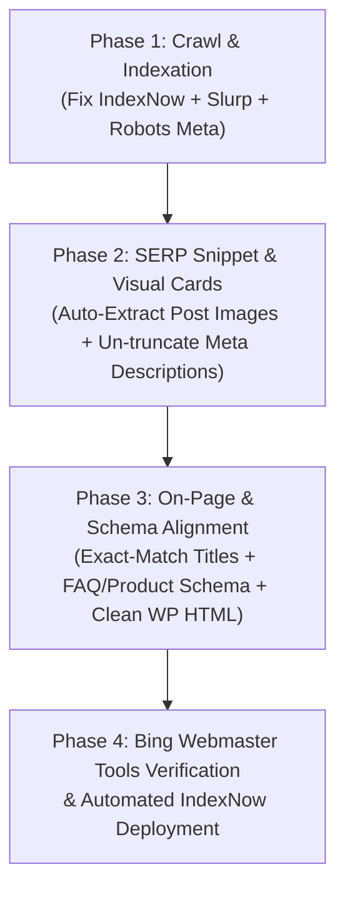

# Yahoo Search Ranking & Technical Visibility Plan (`jackhighbowls.com`)

## 1. How Yahoo Search Works (And Why Technical Changes Matter Here)

Understanding Yahoo's architecture is the key to ranking on it:
1. **Yahoo's Core Organic Index is Powered by Microsoft Bing:** Yahoo Search derives its core web organic rankings, structured data parsing, and instant indexation directly from **Microsoft Bing's index** (via the Bing/Yahoo Search Alliance) alongside Yahoo's own crawler (**`Slurp`**) for Yahoo-specific vertical features and snippet enrichment.
2. **Demographic Sweet Spot for Lawn Bowls:** Yahoo and Bing heavily over-index among **UK & Commonwealth desktop/tablet users aged 50+** (due to default Windows/Edge/Yahoo Mail search bars)—which aligns directly with club lawn bowlers researching bowls bias, sizes, and rules.
3. **Different Ranking Signals than Google:** Compared to Google, the Bing/Yahoo ranking engine places **significantly heavier weight** on:
   - **Exact-match keywords** in `<title>`, `<h1>`, `<h2>`, and URL slugs.
   - **IndexNow instant push notifications** (which Bing/Yahoo use to index new or updated pages in minutes rather than weeks).
   - **Unique OpenGraph (`og:image`) and Schema.org `Article` images** for visual SERP cards.
   - **Complete, untruncated `<meta name="description">` tags** and explicit `<meta name="robots">` directives.
   - **Clean HTML-first content** without excessive WordPress Gutenberg block comment clutter (`<!-- wp:paragraph -->`).

---

## 2. Technical Audit of `jackhighbowls.com`: 6 Yahoo/Bing Bottlenecks Found

During a technical inspection of the repository, I found **6 concrete codebase issues** currently holding back your visibility on Yahoo and Bing:

| # | Technical Issue Found in Repo | File Location | Impact on Yahoo / Bing |
| :--- | :--- | :--- | :--- |
| **1** | **Broken IndexNow Hostname & Path** | [`tools/submit_indexnow.py`](../tools/submit_indexnow.py) | `HOST` is hardcoded to `"krussll.github.io"` and `KEY_LOCATION` points to `https://krussll.github.io/jhb/e3d7a858cb5d4380a133c9475c4eb18c.txt`, while your live `sitemap.xml` and `CNAME` use **`jackhighbowls.com`**. **IndexNow rejects cross-domain payloads (HTTP 403/422)**, meaning none of your IndexNow pings to Bing/Yahoo are being accepted! |
| **2** | **345 of 347 Posts Share the Exact Same `og:image` & Schema Image** | [`_includes/head.html`](../_includes/head.html) | Because **345 out of 347 posts** do not have `image:` or `background:` in their YAML frontmatter (their images are embedded inside the post body as ``), `head.html` falls back to `/img/posts/jack-high-bowls-success.png` on 99.4% of your articles. Yahoo & Bing heavily penalize duplicate sitewide thumbnails in rich SERP cards and image search. |
| **3** | **Meta Descriptions Are Artificially Truncated at 25 Words** | [`_includes/head.html`](../_includes/head.html) | Line 11 runs `truncatewords: 25` on every `page.description`, cutting carefully written 150–160 character SEO descriptions mid-sentence with `...` in `<meta name="description">`, `og:description`, and `Article` JSON-LD. Yahoo relies directly on `<meta name="description">` for snippet copy. |
| **4** | **`Yahoo! Slurp` Missing from `robots.txt` + `<meta name="robots">` Absent** | [`robots.txt`](../robots.txt) & [`_includes/head.html`](../_includes/head.html) | `robots.txt` explicitly whitelists `Bingbot` and `Applebot`, but omits Yahoo's native crawler (`Slurp`). Additionally, `<head>` lacks `<meta name="robots" content="index, follow, max-image-preview:large, max-snippet:-1">`, which authorizes Yahoo/Bing to show large thumbnail cards. |
| **5** | **Dual-Sitemap Conflict in `_config.yml`** | [`_config.yml`](../_config.yml) & [`sitemap.xml`](../sitemap.xml) | You have a custom root `sitemap.xml` template, AND `jekyll-sitemap` enabled in `_config.yml`. Furthermore, the custom `sitemap.xml` only marks `/guides`, `/reviews`, and `/getting-started` as `weekly`, leaving new hubs like `/ai-coaching/` and `/ai-coaching/prompt-builder/` as `monthly`. |
| **6** | **Legacy WordPress HTML Noise (`xmlns` & `<!-- wp:... -->`)** | [`_posts/*.md`](../_posts) | Older posts contain `<p xmlns="http://www.w3.org/1999/xhtml">` and hundreds of `<!-- wp:paragraph -->` comments inside the rendered HTML. Bing/Yahoo's parser is stricter than Google's about HTML-to-text ratio and invalid inline `xmlns` attributes on `<p>` tags. |

---

## 3. Step-by-Step Technical & On-Page Implementation Plan



### Phase 1: Fix Yahoo/Bing Indexation & Crawler Directives

#### 1. Fix [`tools/submit_indexnow.py`](../tools/submit_indexnow.py)
Update `HOST` and `KEY_LOCATION` to match your production domain (`jackhighbowls.com`):
```python
INDEXNOW_KEY = "e3d7a858cb5d4380a133c9475c4eb18c"
HOST = "jackhighbowls.com"
KEY_LOCATION = f"https://{HOST}/{INDEXNOW_KEY}.txt"
```
*Why this matters:* Every time you run `python3 tools/submit_indexnow.py` (or trigger it in GitHub Actions on deploy), Bing and Yahoo are notified within seconds to re-crawl updated reviews and guides.

#### 2. Add `Slurp` (Yahoo Crawler) to [`robots.txt`](../robots.txt)
Explicitly allow Yahoo's `Slurp` crawler alongside `Bingbot`:
```text
User-agent: Slurp
Allow: /
```

#### 3. Add Rich Snippet Robots Meta & Bing Verification Support in [`_includes/head.html`](../_includes/head.html)
Add explicit directives so Yahoo and Bing display large image previews and full text snippets:
```html
<meta name="robots" content="index, follow, max-image-preview:large, max-snippet:-1, max-video-preview:-1">
```
*(Plus an optional `msvalidate.01` meta tag slot in `_config.yml` if you haven't verified `jackhighbowls.com` via DNS in Bing Webmaster Tools).*

---

### Phase 2: Fix Visual SERP Thumbnails & Meta Descriptions in [`_includes/head.html`](../_includes/head.html)

#### 1. Auto-Extract the First Post Image When Frontmatter `image:` Is Missing
In [`_includes/head.html`](../_includes/head.html), if `page.background`, `page.image`, and `page.header_image` are all nil, we can use Liquid string splitting on `page.content` (extracting the first `` URL) before falling back to `/img/posts/jack-high-bowls-success.png`.
- **Result:** All **345 blog posts** will immediately get their own unique product/review photo in `<meta property="og:image">`, `<meta name="twitter:image">`, and Schema.org `Article` / `Review` JSON-LD without even needing to manually edit 345 files (though we can also run a quick Python script to populate `image:` in frontmatter for permanent cleanliness).

#### 2. Stop Cutting Meta Descriptions Mid-Sentence
Replace `truncatewords: 25` in [`_includes/head.html`](../_includes/head.html) with full `page.description` support (only falling back to `truncate: 160` when `page.description` is missing and `page.excerpt` is used).
- **Result:** Yahoo and Bing will display complete, persuasive meta descriptions in search results instead of cut-off sentences ending in `...`.

---

### Phase 3: On-Page & Schema Optimizations for Yahoo's Ranking Algorithm

Because Yahoo/Bing rely more heavily on **exact-match lexical signals** and **structured HTML tables/lists** than Google's purely semantic vector matching:

1. **Exact-Match Title & H1 Alignment on "Best X for Y" & "vs" Pages:**
   - Yahoo rewards titles that front-load the exact query and include fresh year/category modifiers where appropriate (e.g., *"Best Lawn Bowls for Beginners (2026 UK Buyer's Guide)"*) while keeping the `<title>` under 65 characters so it doesn't truncate on Yahoo desktop SERPs.
2. **HTML Cleanup Across `_posts/` (Removing WordPress Artifacts):**
   - Strip invalid `xmlns="http://www.w3.org/1999/xhtml"` attributes on `<p>` tags and remove `<!-- wp:... -->` Gutenberg comments across `_posts/` so Yahoo/Bing crawlers parse clean, high signal-to-noise HTML5.
3. **`FAQPage` & `Product` JSON-LD Schema:**
   - Bing/Yahoo actively use `FAQPage` and `Product` schema to populate "People Also Ask" and rich product cards on Yahoo SERPs. Adding `FAQPage` schema to key buyer guides and `Product` schema to `/lawn-bowls-downloadable-drill-pack/` directly feeds Yahoo's rich result panels.

---

### Phase 4: Off-Page & Ecosystem Signals Specific to Yahoo/Bing

1. **Bing Webmaster Tools (Powers Yahoo Organic):**
   - Ensure `jackhighbowls.com` (not just the old `krussll.github.io/jhb`) is verified in [Bing Webmaster Tools](https://www.bing.com/webmasters) and submit `https://jackhighbowls.com/sitemap.xml`.
2. **Social Profiles in `_config.yml` & `Organization` Schema (`sameAs`):**
   - Currently in [`_config.yml`](../_config.yml), `twitter_username`, `facebook_username`, etc. are blank. Unlike Google, Bing/Yahoo explicitly use **social signals and entity `sameAs` links** in `Organization` / `Person` schema to verify brand authority.

---

## 4. Summary of Files We Can Update Immediately

| File | Proposed Technical Change |
| :--- | :--- |
| [`tools/submit_indexnow.py`](../tools/submit_indexnow.py) | Fix `HOST = "jackhighbowls.com"` and `KEY_LOCATION = "https://jackhighbowls.com/e3d7a858cb5d4380a133c9475c4eb18c.txt"` so IndexNow submissions to Bing/Yahoo succeed. |
| [`_includes/head.html`](../_includes/head.html) | 1. Remove the `truncatewords: 25` cap when `page.description` is defined.<br>2. Auto-extract the first post image for `og:image` and Schema `image` across all 345 posts.<br>3. Add `<meta name="robots" content="index, follow, max-image-preview:large, max-snippet:-1, max-video-preview:-1">`. |
| [`robots.txt`](../robots.txt) | Add explicit `User-agent: Slurp` (`Allow: /`) for Yahoo's crawler. |
| [`sitemap.xml`](../sitemap.xml) & [`_config.yml`](../_config.yml) | Resolve the duplicate `jekyll-sitemap` plugin conflict and include `/ai-coaching/` in high-priority weekly crawl rules. |
| [`_posts/*.md`](../_posts) | Optional automated cleanup of `<p xmlns="http://www.w3.org/1999/xhtml">` and `<!-- wp:... -->` comments + frontmatter `image:` population. |
